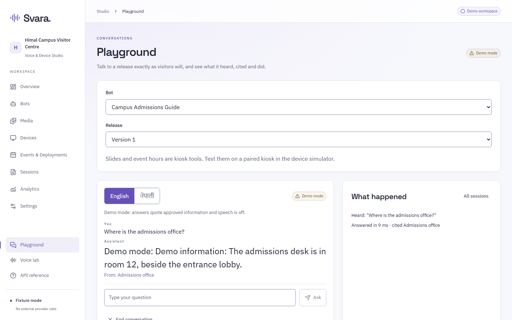

# Svara — Voice & Device Studio

A studio for building bilingual (English and Nepali) voice assistants for visitor
kiosks. Staff write and review knowledge in both languages and publish it as an
immutable release. They pair browser kiosks, schedule which release each kiosk runs,
and then read every conversation with what was heard, cited and done. Visitors can ask
at a kiosk or through a public link, and answers quote only approved content.

Next.js studio, NestJS API and a worker over PostgreSQL 17 and Redis, behind one Caddy
gateway. Without a provider key it runs in a clearly labelled demo mode. A free Google
AI Studio key turns on live transcription, answers and speech. The organisations and
content are synthetic.



_The seeded Himal Campus guide answering in demo mode, captured on 8 November 2026.
Demo mode quotes approved text and has no speech._

## Try it

Needs Docker Desktop with Compose v2.24+ and pnpm 10. pnpm fetches the pinned Node 22
for project commands.

```sh
pnpm install --frozen-lockfile && pnpm setup:local && pnpm demo:up
```

Open http://localhost:4320 and sign in as `owner@himal.svara.test`. `setup:local`
writes gitignored `.env` files with fresh secrets. The seed writes each staff
account's generated password to `.local/setup/demo-staff.json`. `pnpm demo:down`
stops the stack and keeps its data.

Last run from a fresh clone on 8 November 2026 (Windows 11, Docker Desktop): the
images built, migration and seeding finished, all services reported healthy and the
playground answered from the published release.

Things to try:

- **Playground**: ask the Campus Admissions Guide a question in English or Nepali and
  see what it cited.
- **Bots → Campus Admissions Guide → Releases**: the current draft is missing a Nepali
  greeting on purpose, so the readiness check blocks it. The published version stays
  complete.
- **Devices**: pair the device simulator as a kiosk, then schedule a release for it in
  **Events & Deployments**.
- **Settings → Public assistant links**: open a public link in another browser profile.

[Development](docs/DEVELOPMENT.md) covers native development, the media library, the
voice lab, backups and every check command. [Free demo setup](docs/FREE-DEMO-SETUP.md)
explains how to add a live key.

## Tests and CI

| Suite                      | Size                                                                         | Runs against                                                                                                                    |
| -------------------------- | ---------------------------------------------------------------------------- | ------------------------------------------------------------------------------------------------------------------------------- |
| Unit (Vitest)              | 190 cases in 37 files, statement coverage above 95% on the measured packages | Node                                                                                                                            |
| Integration (Vitest)       | 173 cases in 31 files                                                        | Real PostgreSQL 17 and Redis: tenant isolation, revision conflicts, schedule races, pairing and admission limits                |
| Browser (Playwright + axe) | 46 tests in 16 specs                                                         | The full stack: pairing, schedules, kiosk slide commands, public links in both languages, layouts at three widths and 200% zoom |
| Conversation evaluation    | 40 fixed bilingual cases                                                     | Demo mode; also runs live with a key                                                                                            |

`pnpm check` runs formatting, lint, types, unit tests with coverage, contract drift
checks and production builds. GitHub Actions runs it with the dependency audit,
integration tests, the evaluation and the browser journeys on every push to `main`.
**The last run on `main` passed, on 9 October 2026 (`856a688`).**

## Engineering decisions

**A kiosk's desired release is committed with the change that caused it.** A staff
change derives each device's desired release (override, then schedule, then idle) in
the same transaction. That transaction bumps a revision and writes the next command
row, so the command table is the outbox. Redis messages carry only IDs and just wake
the worker, and a lost one is repaired on the next scan.
([ADR 026](docs/DECISIONS.md#adr-026--desired-state-and-its-command-commit-together-redis-only-wakes))

**Releases are immutable, and answers come only from them.** Publishing captures a
draft into a hashed snapshot together with per-language knowledge projections and
media references, all in one transaction. A conversation searches only its pinned
release. The model sees short passage and slide labels, never database IDs. The
server maps those labels back and checks them against the release before any tool
call runs. ([ADR 022](docs/DECISIONS.md#adr-022--immutable-release-captures-with-matching-projections),
[ADR 027](docs/DECISIONS.md#adr-027--conversation-turns-stream-over-http-admission-serializes-in-postgresql))

**Usage limits are enforced in PostgreSQL, not Redis.** Each conversation is
admitted by locking the organisation's daily usage row, counting active sessions
and checking allowances in one transaction. The limits therefore survive a Redis
restart. Conversation turns stream over HTTP instead of a voice socket, because the
recognizer transcribes a whole utterance anyway.
([ADR 027](docs/DECISIONS.md#adr-027--conversation-turns-stream-over-http-admission-serializes-in-postgresql))

## Known limits

- **Live quality is not proven.** Every case in the 40-case set has a correct live
  answer, but those answers came from four different free-tier models. There has been
  no single live run on one model, and no browser run with a real key.
- **Nepali has not been reviewed by a fluent speaker.**
- **No hands-free barge-in or streaming recognition.** Speech is transcribed after the
  visitor finishes, and stopping an answer takes a button press.
- **Citation labels are English only**, even on Nepali screens.
- **Local only.** It runs in Docker Compose on one machine, with no production
  deployment.

More in the [evaluation](docs/EVALUATION.md) and the [case study](docs/CASE_STUDY.md).

## Documentation

- [Development](docs/DEVELOPMENT.md), [operations](docs/OPERATIONS.md), [API](docs/API.md)
- [Decisions](docs/DECISIONS.md) (30 ADRs), [build log](docs/PROGRESS.md), [specification](docs/BLUEPRINT.md)
- [Demo walkthrough](docs/DEMO.md), [evaluation](docs/EVALUATION.md), [case study](docs/CASE_STUDY.md)

## License

No license has been chosen yet, so all rights are reserved.
