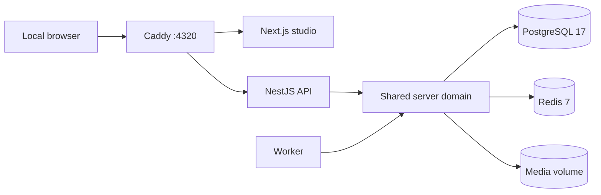

# Svara — Voice & Device Studio

A bilingual English/Nepali visitor assistant and browser kiosk management studio.
Svara is an independent implementation using synthetic organisations and content.

## Build status

**M0 — workspace and component foundation is implemented.** The local studio,
component gallery, NestJS health API, worker heartbeat, PostgreSQL schema, safe
setup/seed, generated contracts and Docker stack run together.

Voice, authentication, authoring and device operations are subsequent milestones.
This is a working foundation, not yet a complete voice assistant. No live provider
credentials are needed or used. See [progress and verification](docs/PROGRESS.md).

## Architecture



Apps compose shared packages. Browser code imports only contracts, UI and audio;
server domain code owns database/provider work. PostgreSQL is durable truth. Redis
will coordinate jobs, tickets and leases. The current worker runs dependency checks
and a heartbeat; Socket.IO and business jobs arrive later.

The planned bilingual pipeline is Azure STT → approved release knowledge → OpenAI
Responses → Azure TTS. Live audio stays transient in its owning API process.

See [the architecture decisions](docs/DECISIONS.md),
[implementation progress](docs/PROGRESS.md) and
[the supplied specification](docs/01-robot-voice.md).

## Prerequisites

- Docker Desktop with Linux containers and Compose v2.24 or newer.
- pnpm 10.34.5. If needed: `corepack enable`, then
  `corepack prepare pnpm@10.34.5 --activate`.
- Node 22.23.2. The workspace pins `useNodeVersion`, so pnpm obtains the correct
  runtime for project commands without replacing a different host Node version.
- Internet for the first dependency/image install; no provider account is required.

## Run the complete local demo

From the repository root:

```sh
pnpm install --frozen-lockfile
pnpm setup:local
pnpm demo:up
```

Open [Svara](http://localhost:4320), the
[component gallery](http://localhost:4320/studio/design-system), or
[API reference](http://localhost:4320/api/docs).

Setup creates ignored `.env` and `.env.compose` files with fresh secrets and never
overwrites existing files. Compose builds the apps, runs migration and seed init
jobs, and waits for health checks. Only `127.0.0.1:4320` is exposed.
Stop with `pnpm demo:down`; named data volumes are retained.

**No sign-in exists in M0.** Studio/gallery access requires local fixture mode and
a loopback Host; production mode returns 404. The seed creates only the fictional
Himal and Riverside organisations. Staff accounts and generated credentials arrive
in M2; there is no default password.

## Native development

Stop the full demo first if running: `pnpm demo:down`.

```sh
pnpm setup:local
pnpm infra:up
pnpm db:generate
pnpm db:migrate
pnpm db:seed
pnpm dev
```

Use `http://localhost:4320`. Native web uses port 3001, API 4100, worker 4101,
PostgreSQL 5434 and Redis 6381. Port 3001 avoids an unrelated service on this machine;
containers use web port 3000 internally. Ctrl+C stops the coordinated app watchers;
`pnpm infra:down` stops infrastructure while retaining data.

## Verification

```sh
pnpm check                 # format, lint, types, unit coverage, contract drift, builds
pnpm audit                 # all dependency groups
pnpm test:integration      # requires native infrastructure
pnpm exec playwright install chromium
pnpm test:e2e              # requires the complete running app
```

For the full Compose demo use `pnpm test:integration:container` instead of the native
integration command. `pnpm test:container` verifies production preview denial in a
separate container with networking disabled. `pnpm screenshots` captures the actual
overview at five viewport sizes in ignored `artifacts/screenshots/`.

`pnpm contracts:generate` updates OpenAPI and HTTP types; `pnpm contracts:check`
fails on drift without rewriting them. Tests do not call speech/LLM providers.
Integration commands accept only the explicitly local `svara_test` database.

The GitHub Actions workflow is ready for a future remote; it has not been run on
GitHub or published. See [contributing](CONTRIBUTING.md),
[operations](docs/OPERATIONS.md), [API contracts](docs/API.md), and
[dependency decisions](docs/DEPENDENCIES.md).
