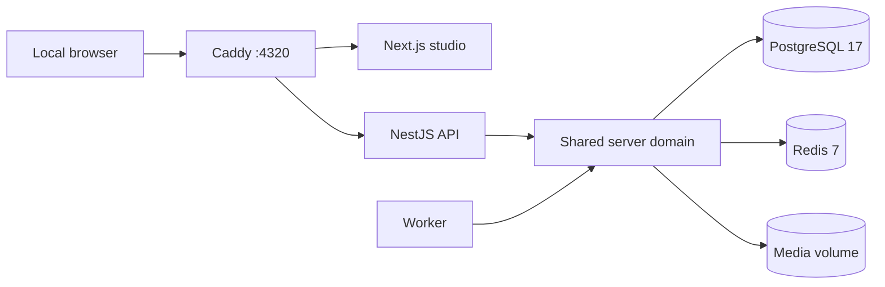

# Svara — Voice & Device Studio

A bilingual English/Nepali visitor assistant and browser kiosk management studio.
Svara is an independent implementation using synthetic organisations and content.

## Build status

**M0 — workspace and component foundation is implemented.** The local studio,
component gallery, NestJS health API, worker heartbeat, PostgreSQL schema, safe
setup/seed, generated contracts and Docker stack run together.

**M1's local fixture lab is implemented.** The bilingual lab includes scripted
English/Nepali subtitles, typed fallback, interruption, measured fixture timings,
microphone capture and PCM speaker checks. Live recognition/generation/synthesis
and their bilingual quality gate remain pending provider setup. The professional
light theme uses white surfaces and a subtle lavender gradient.

**M2 identity is implemented:** register/sign in, scoped cookie sessions,
organisation settings, team invitations, recovery links, role changes and workspace
switching work through the browser and API. Demo staff credentials are generated
locally; an explicit local recovery command revokes sessions and preserves roles.
See [identity scope](docs/M2-IDENTITY.md), [free provider account setup](docs/FREE-DEMO-SETUP.md)
and [progress and verification](docs/PROGRESS.md).

**M3 bot drafts and knowledge are implemented:** scoped search, bilingual editing,
revision conflicts, read-only roles, archive/restore, FAQ/reference approval and
release inclusion. Media, presentations and immutable publication are next.
See [authoring scope](docs/M3-AUTHORING.md).

## Architecture



Apps compose shared packages. Browser code imports only contracts, UI and audio;
server domain code owns database/provider work. PostgreSQL is durable truth. Redis
will coordinate jobs, tickets and leases. The current worker runs dependency checks
and a heartbeat; Socket.IO and business jobs arrive later.

The demo pipeline is Azure Speech F0 STT → approved release knowledge → Gemini
free-tier generation → Azure Speech F0 TTS. Provider adapters and live validation
are pending. OpenAI is an optional explicit alternative. Live audio will stay
transient in its owning API process.

See [the architecture decisions](docs/DECISIONS.md),
[implementation progress](docs/PROGRESS.md) and
[the supplied specification](docs/01-robot-voice.md).

## Prerequisites

- Docker Desktop with Linux containers and Compose v2.24 or newer.
- pnpm 10.34.5. If needed: `corepack enable`, then
  `corepack prepare pnpm@10.34.5 --activate`.
- Node 22.23.2. The workspace pins `useNodeVersion`, so pnpm obtains the correct
  runtime for project commands without replacing a different host Node version.
- Internet for the first dependency/image install; no provider account is required.

## Run the complete local demo

From the repository root:

```sh
pnpm install --frozen-lockfile
pnpm setup:local
pnpm demo:up
```

Open [Svara](http://localhost:4320), the
[voice lab](http://localhost:4320/studio/voice-lab),
[component gallery](http://localhost:4320/studio/design-system), or
[API reference](http://localhost:4320/api/docs).

Setup creates ignored `.env` and `.env.compose` files with fresh secrets and never
overwrites existing files. Compose builds the apps, runs migration and seed init
jobs, and waits for health checks. Only `127.0.0.1:4320` is exposed.
Stop with `pnpm demo:down`; named data volumes are retained.

The studio requires sign-in. Choose **Create a workspace** at `/login` to create
your own organisation and owner account. The seed currently creates only the
fictional Himal and Riverside organisations, with five staff accounts covering all
roles. Read the generated passwords in `.local/setup/demo-staff.json`; native and
Compose modes share this ignored file. No default password is committed. The voice
lab and component gallery additionally require local fixture
mode, including after sign-in. Free provider account instructions are linked above.

## Native development

Stop the full demo first if running: `pnpm demo:down`.

```sh
pnpm setup:local
pnpm infra:up
pnpm db:generate
pnpm db:migrate
pnpm db:seed
pnpm dev
```

Use `http://localhost:4320`. Native web uses port 3001, API 4100, worker 4101,
PostgreSQL 5434 and Redis 6381. Port 3001 avoids an unrelated service on this machine;
containers use web port 3000 internally. Ctrl+C stops the coordinated app watchers;
`pnpm infra:down` stops infrastructure while retaining data.

## Explore the voice lab

1. Choose English or Nepali and run a scripted scenario. The admissions facts are
   synthetic; the missing-fee scenario demonstrates an unsupported question.
2. Select the long answer and press Interrupt. Partial subtitles remain labelled;
   changing language or choosing End & clear cancels and clears the current turn.
3. Test microphone capture separately. Frames remain in the browser; this is not
   recognition. Stop is available during permission prompts and capture ends after
   30 seconds. Navigation and language changes release the microphone.
4. Test the speaker with a generated 440 Hz tone. This uses the actual PCM worklet
   queue. English/Nepali speech clips are not bundled, so fixture answers stay
   explicitly text-only. Typed questions receive a fixture notice, not generated facts.

See [M1 design, evidence and limits](docs/M1-VOICE.md). Restart `pnpm dev` after editing
worklet source so the compiled public worklet modules are refreshed.

## Verification

```sh
pnpm check                 # format, lint, types, unit coverage, contract drift, builds
pnpm audit                 # all dependency groups
pnpm test:integration      # requires native infrastructure
pnpm exec playwright install chromium
pnpm test:e2e              # requires the complete running app
```

For the full Compose demo use `pnpm test:integration:container` instead of the native
integration command. `pnpm test:container` verifies production preview denial in a
separate container with networking disabled. `pnpm screenshots` captures the actual
overview at five viewport sizes in ignored `artifacts/screenshots/`.

`pnpm contracts:generate` updates OpenAPI and HTTP types; `pnpm contracts:check`
fails on drift without rewriting them. Tests do not call speech/LLM providers.
Integration commands accept only the explicitly local `svara_test` database.

The GitHub Actions workflow is ready for a future remote; it has not been run on
GitHub or published. See [contributing](CONTRIBUTING.md),
[operations](docs/OPERATIONS.md), [API contracts](docs/API.md), and
[dependency decisions](docs/DEPENDENCIES.md).
