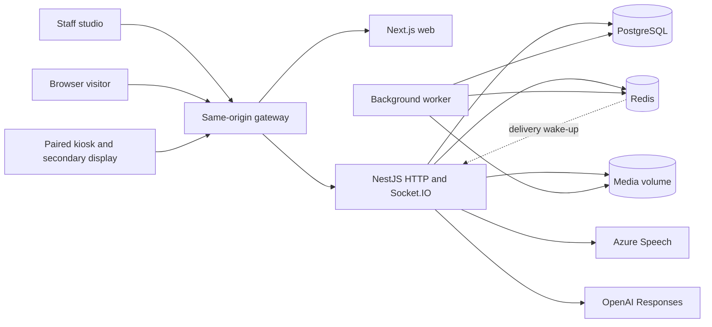
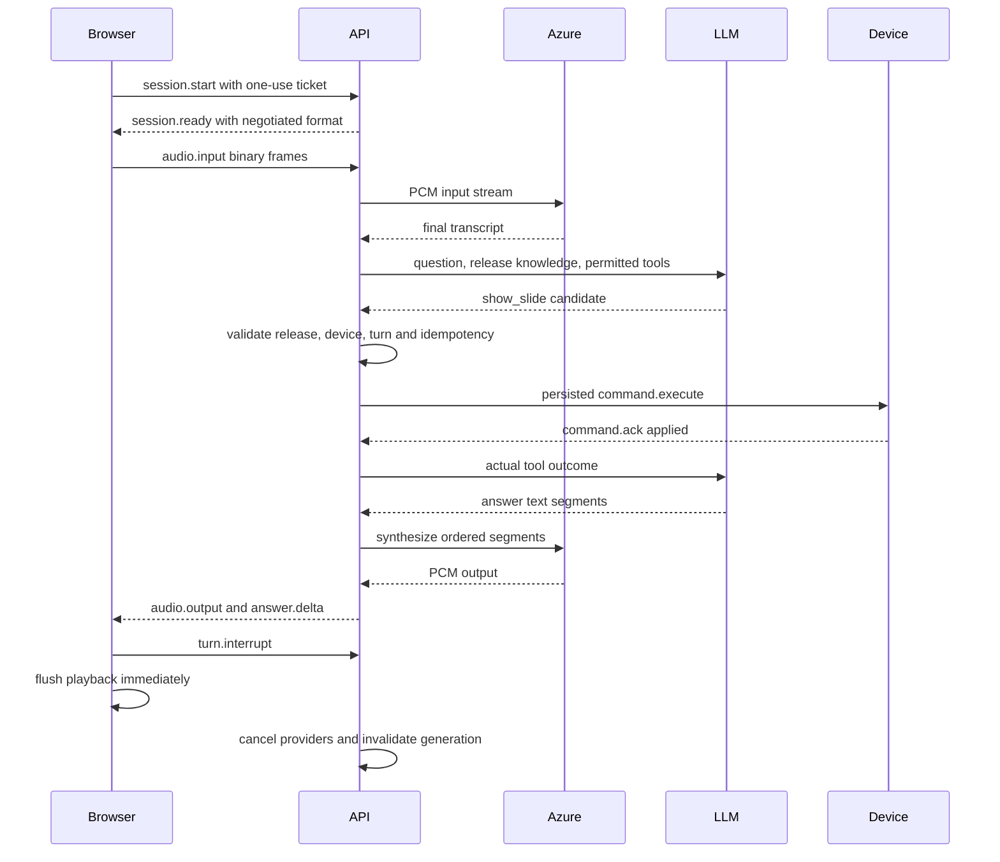

# Svara — Voice & Device Studio

> Project 1 of 9: independent recreation of Custom Robot Voice.
> Status: implementation-ready specification; application implementation has not started.
> Specification version: 1.0 — 8 September 2026.
> Audience: an engineer or Codex task starting with no prior conversation context.

## 0. Start here

Build a new, independently branded working demo of a bilingual voice-assistant and kiosk-management platform. This document is the complete handoff for this project: product scope, architecture, contracts, design system, build sequence, testing and demonstration requirements.

The user explicitly chose fresh construction, a complete voice/device/media/scheduling platform, English and Nepali, local operation with optional cloud AI, and a professional design specific to this product. Preserve those decisions. Do not turn this into a screenshot-only frontend or expand it into a robot-hardware project.

### Location and ownership

- This specification lives in the portfolio repository at `docs/project-blueprints/01-robot-voice.md`.
- Create the application in a separate repository at `<projects-root>/portfolio-recreations/robot-voice/`.
- On the original machine, `<projects-root>` is `C:/Users/khatr/OneDrive - Prime College/Desktop/Project`. On another machine, use the directory the user supplies, never recreate the original absolute path blindly.
- If the destination already exists, inspect its instructions, status and progress before continuing. Do not overwrite or reset existing work.
- Copy this specification into the new application's `docs/BLUEPRINT.md`; record implementation progress in `docs/PROGRESS.md` there.
- Existing CRV source is reference material only. The new application must work without that checkout. Do not copy its environment files, databases, employer assets or historical Git metadata.
- Do not edit the portfolio application or any other project as part of implementing this blueprint. Return screenshots and case-study material for a later portfolio update.

### Reading map

1. Product decisions and success scenario.
2. Runtime architecture and repository boundaries.
3. Data model and invariants.
4. Identity, access and public exposure.
5. Content authoring and release publishing.
6. Device operations, media and scheduling.
7. Voice, knowledge and provider contracts.
8. HTTP API.
9. Realtime protocol.
10. Background jobs, recovery and observability.
11. Professional design system.
12. Routes and screen specifications.
13. Local setup and configuration.
14. Synthetic data and fixture mode.
15. Build milestones.
16. Verification and acceptance.
17. Screenshots, walkthrough and handoff.
18. Architecture decisions and primary references.
19. Copy-ready opening prompt.

## 1. Product decisions

### Purpose and audience

**Svara** lets an organisation publish a bilingual visitor assistant, deploy it to browser kiosks, synchronise supporting presentations and inspect what happened during a conversation. The staff experience should feel like reliable operational software; the visitor experience should feel welcoming and immediately understandable.

The principal personas are:

| Persona | Job to accomplish | Main evidence of success |
|---|---|---|
| Organisation owner | Set up the workspace and manage staff access | Other roles can do their jobs without gaining owner privileges |
| Administrator | Author accurate assistants and presentations | A published release is coherent, bilingual and reproducible |
| Operator | Pair and supervise kiosks, schedule deployments | Desired and applied configurations are visible and recover after interruptions |
| Visitor | Obtain a useful answer in English or Nepali | Speech, subtitles and supporting slides agree |
| Portfolio reviewer | Understand the engineering | A short walkthrough shows real state changes, failure recovery and measured results |

### Included in this edition

- Multiple organisations with separate users, content, devices and sessions.
- Staff account setup, role management and server-side sessions.
- Bot drafts, approved bilingual FAQs/reference notes and immutable releases.
- Validated image/video uploads and structured presentation editing.
- Device pairing, revocation, presence and primary/secondary display simulation.
- Event metadata, deployment scheduling, manual overrides and reconciliation.
- Browser speech and typed conversations, interruption and reconnect behavior.
- Grounded answers, permitted presentation commands and acknowledgements.
- Revocable public assistant links with limited visitor capabilities.
- Session history, citations, tool outcomes and measured operational analytics.
- Deterministic fixture mode plus real Azure/OpenAI provider integration.
- Responsive staff screens, bilingual visitor screens and accessible interactions.

### Explicit boundaries

- Browser assistant and simulated kiosk only; no Flutter client, robot motors, navigation or hardware SDK.
- No billing, commercial subscriptions, customer-support impersonation or platform-superadmin product.
- No arbitrary web browsing, uploaded-document RAG, general shell tools or autonomous external actions.
- Knowledge in this project consists of approved FAQs and plain-text notes. The separate RAG project owns document ingestion and vector retrieval.
- No browser Web Speech API for recognition. Browser audio capture is allowed; recognition is performed by the configured server provider.
- English staff navigation; English and Nepali visitor interface/content/speech. Automatic language detection and arbitrary code-switching are outside acceptance.
- Initial runtime is one API instance and one worker. This edition does not claim multi-node seamless voice failover.
- Local completion is required. Publishing repositories, provisioning cloud services and deploying a public site are separate actions.

### Demonstration scenario

Seed a fictional **Himal Campus Visitor Centre** and a separate **Riverside Exhibition Centre**. They are invented demo organisations, not client identities.

The owner creates an admissions assistant, approves bilingual knowledge, adds a presentation, publishes a release, pairs a kiosk, schedules an open-house deployment and tests it. A visitor asks an English question, switches to Nepali, requests the admissions slide and interrupts a long answer. A simulated disconnect is recovered. The operator then inspects the transcript, knowledge references, command acknowledgement and timing measurements.

All information about fees, rooms and schedules in this demonstration is synthetic and labelled as demo content.

## 2. Architecture

### Runtime topology

Use a modular NestJS application and a separate worker, with PostgreSQL as the durable source of truth. Redis coordinates leases, tickets and jobs. One Next.js application provides separate staff, visitor and simulator layouts.



Durable changes are committed before notifying clients. Live audio is transient and stays with its owning API process; do not pass audio through a job queue or persist it in Redis/PostgreSQL.

### Technology choices

| Concern | Required choice |
|---|---|
| Runtime | Node.js 22 LTS, minimum 22.12; current patched 22.x at scaffolding |
| Package management | pnpm 10 workspace; one committed lockfile |
| Web | Next.js 16 App Router, React 19, TypeScript strict mode |
| Styling | Tailwind CSS 4 and named CSS custom properties |
| Accessible primitives | Base UI; style primitives to Svara tokens |
| Icons | Lucide; text labels for unfamiliar actions |
| Server state | TanStack Query; invalidate from realtime notifications |
| Forms | React Hook Form and Zod |
| API | NestJS 11 with Express, Swagger/OpenAPI |
| Persistence | Prisma ORM 7 with PostgreSQL adapter; PostgreSQL 17 |
| Coordination/jobs | Redis 7, BullMQ |
| Realtime | Socket.IO 4, WebSocket transport |
| Recognition/synthesis | Microsoft Speech SDK, server-side |
| Language generation | OpenAI Responses SDK adapter; configurable model |
| Media inspection | Sharp for images; sandboxed, timeout-bounded ffprobe for MP4 metadata |
| Local proxy | Caddy 2 in Docker Compose |
| Tests | Vitest, React Testing Library, Supertest, Playwright and axe-core |

Pin compatible package patches during milestone M0. Commit generated clients and dependency choices according to the selected Prisma version's official guidance; configure Prisma 7 through its current config/adapter conventions instead of copying the old CRV schema setup. Native tools run in Debian-based containers for reproducibility on Windows.

Read `node_modules/next/dist/docs/` in the newly installed application before framework-specific implementation. Staff/visitor data must never enter a shared server render cache. Use server components for shells and public static copy; client components own interactive audio, query state, forms and device controls.

### Repository layout

```text
robot-voice/
  apps/
    web/                 # staff, visitor, simulator and design-system gallery
    api/                 # NestJS HTTP + Socket.IO composition root
    worker/              # job and reconciliation composition root
  packages/
    domain/              # reusable server-only services and repositories
    database/            # Prisma schema, migrations, adapter and seed
    contracts/           # request/event schemas and generated HTTP types
    providers/           # server-only speech, LLM and fixture adapters
    audio/               # capture, resampling, worklets, playback state
    ui/                  # tokens and reusable accessible components
    config/              # shared lint/type/test configuration
  fixtures/              # synthetic content, protocols and audio fixtures
  infra/                 # containers, Caddy and health configuration
  tests/                 # contract, integration, browser and evaluation suites
  docs/                  # blueprint, decisions, progress and runbooks
```

Dependency direction: apps may import packages; `domain` may import database/contracts/providers; web may import contracts/ui/audio. Database, domain and providers are server-only and cannot be imported into web bundles. Packages never import an app. API and worker reuse domain services, not each other's entrypoints.

### Domain boundaries

| Module | Owns |
|---|---|
| Identity | Users, memberships, staff sessions and policies |
| Bots | Draft editing, revisions, release validation and publishing |
| Knowledge | Bilingual entries, approval and release-local search |
| Media | Upload lifecycle, object authorization and integrity |
| Presentations | Structured slides, ordering and presentation validation |
| Devices | Pairing, credentials, runtime grants and presence |
| Deployments | Events, schedules, manual overrides and desired state |
| Conversations | Session ownership, turns, provider lifecycle and citations |
| Commands | Allowed actions, persistence, retry and acknowledgement |
| Analytics | Session queries, aggregate metrics and audit visibility |

Controllers/gateways validate and authorize, then call services. Domain services own transactions. Database queries require an explicit organisation scope. Raw SQL is parameterized and limited to search, locking and constraints not expressible through Prisma.

## 3. Data model and invariants

UUIDs identify records. Timestamps use PostgreSQL `timestamptz`; transport uses ISO 8601 UTC. Mutable resources have an integer `revision` for optimistic concurrency. Use `organisationId` consistently in code and contracts.

### Entity dictionary

| Entity | Key fields and constraints |
|---|---|
| Organisation | `id`, `name`, `timezone=Asia/Kathmandu`, configured limits, timestamps |
| User | `id`, canonical lowercase email unique, display name, Argon2id password hash, disabled flag |
| Membership | `organisationId`, `userId`, role, enabled; unique organisation/user |
| StaffSession | token hash, user, active organisation, absolute/idle expiry, revoked time |
| AccountActionToken | hashed one-use invitation/recovery token, intended email/user, organisation, granted role if invitation, expiry, consumed time |
| IdempotencyRecord | actor scope, operation, key hash, request hash, outcome/status, expiry; unique actor/operation/key |
| Bot | organisation, name, description, draft revision, archived time |
| BotDraft | bot, greeting/fallback translations, persona, voice choices, permitted tools, selected presentation |
| KnowledgeEntry | organisation, bot, type `FAQ/NOTE`, title, EN/NE content, optional bilingual FAQ question, approval status, revision |
| Presentation | organisation, bot, name, revision |
| Slide | organisation, presentation, ordered integer position, bilingual title/body, optional media ID, `PRIMARY/SECONDARY/BOTH`, duration |
| MediaAsset | organisation, storage key, original display filename, detected MIME, byte count, SHA-256, dimensions/duration, state |
| BotRelease | organisation, bot, kind `PUBLISHED/PREVIEW`, published version or null, preview expiry or null, immutable config/knowledge/slides/media snapshot, snapshot hash; unique bot/version |
| ReleaseKnowledge | organisation, release, snapshot entry ID, locale, text and search fields; immutable indexed projection of snapshot |
| ReleaseMedia | organisation, release, media ID; explicit reference for deletion protection |
| Device | organisation, name, capabilities, enabled, desired revision, applied revision, lastSeen |
| DeviceCredential | device, token hash, created/last-used/revoked times; no plaintext token |
| PairingChallenge | device, code hash, expiresAt, redeemedAt, attempt count |
| Event | organisation, name, venue, timezone, suggested start/end, archived time |
| Deployment | organisation, device, release, optional event, kind `SCHEDULED/OVERRIDE`, start/end, cancelledAt |
| DesiredDeviceState | device unique, monotonically increasing revision, release ID or idle state, governing deployment |
| DeviceCommand | organisation, device, command ID, type, payload, expected state revision, expiresAt, nextAttemptAt, claimUntil, attempts, status and outcome |
| AssistantLink | organisation, slug unique, pinned release, enabled, expiry; optional publicity label |
| VisitorGrant | hashed cookie token, assistant link, expiry and per-visitor usage counters |
| ConversationSession | organisation, release, actor kind, device/link, locale, status, start/end, provider mode, interruption/resume metadata |
| ConversationTurn | session, ordinal, input kind, transcript, answer, state, cited release-entry IDs, generation ID, timings |
| ToolExecution | session/turn, unique provider call ID, allowlisted name, validated args, command ID, result |
| DailyUsage / UsageReservation | organisation + UTC usage date counters; per-session reserved/settled seconds and generation limits, reservation status |
| AuditEvent | organisation, actor, action, entity type/ID, correlation ID, timestamp and non-secret change summary |

Do not store whole conversation histories only as one mutable JSON blob. Persist turns incrementally. Configuration snapshots may be JSON because a release is an immutable composed document.

### Constraints and indexing

- Add unique `(id, organisationId)` keys where needed and composite foreign keys to prevent cross-organisation bot/device/media/release associations.
- Membership is the only authority for staff roles; request bodies do not establish organisation identity.
- Preserve the final enabled owner of an organisation. Ownership changes run in a transaction.
- Unique `(botId, version)` release numbering is allocated while locking the bot row.
- Publishing reads one draft revision and its children in a transaction; mismatch returns `409 REVISION_CONFLICT`.
- Slide reorder checks the presentation revision and accepts each current slide ID exactly once; no partial order or duplicate positions.
- Add organisation/date and device/date indexes for sessions, deployments, commands and audits. Add status/next-attempt indexes for pending jobs.
- Use `pg_trgm` indexes and an English text-search vector on release knowledge; Nepali uses normalized trigram matching rather than an English stemmer.
- Database constraints require `endsAt > startsAt`, positive slide duration and bounded asset sizes.
- Archive business configuration that has historical references. Hard-delete eligible draft content and unreferenced files; do not cascade away releases or audit history accidentally.

### Immutable release contents

A release freezes bot identity, persona, bilingual greetings/fallbacks, voice configuration, tool allowlist, approved knowledge, ordered slides and media checksums. Runtime conversations pin a release ID at admission. Draft edits and later publishing cannot silently change a running session.

Only selected approved entries enter the release. Publishing requires both English and Nepali versions of each selected entry and slide text; missing translations are actionable field errors. A note may be excluded from publishing until translated.

## 4. Identity, authorization and exposure

### Staff authentication

Use opaque 256-bit session tokens in HttpOnly, SameSite=Lax cookies. Store only token hashes server-side. Cookies are Secure under HTTPS; local HTTP is allowed only on loopback. Session absolute lifetime is eight hours and idle timeout is 30 minutes. Rotate at login and organisation switch; revoke on password/role/access changes. Resolve membership on each authenticated operation.

Expose a synchronizer CSRF token to the authenticated web app; check it on cookie-authenticated mutations. Validate Origin for HTTP mutations and Socket.IO handshakes. Allow only the configured application origin. Trust forwarded headers solely from the configured gateway hop.

Registration creates one user, organisation and owner membership atomically. This demo has no outbound email dependency: an owner creates staff invitations as one-use activation links displayed once, expiring after 24 hours. Activation sets the password. Never grant owner by public registration into an existing organisation. Password reset is an owner-issued single-use link or an explicit local recovery command, not an unauthenticated arbitrary reset.

| Action | Owner | Administrator | Operator | Viewer |
|---|---|---|---|---|
| Manage organisation, roles and recovery links | Yes | No | No | No |
| Edit bots, knowledge and presentations | Yes | Yes | No | No |
| Approve knowledge and publish releases | Yes | Yes | No | No |
| Pair/revoke devices; schedule published releases | Yes | Yes | Yes | No |
| Create/disable public assistant links | Yes | Yes | No | No |
| Inspect sessions and operational metrics | Yes | Yes | Yes | Yes |
| Delete retained transcripts | Yes | Yes | No | No |

Return `404` for cross-organisation resource IDs. Return `403` for an authenticated member attempting a disallowed action on their own organisation's resource. Prevent information leakage in filenames, aggregates, download endpoints and socket rooms as well as CRUD endpoints.

### Device and visitor authentication

Pairing redeems a six-character unambiguous alphanumeric one-use code, valid for five minutes. Limit failures to five per challenge and ten per IP per minute. Store its hash. Redemption atomically consumes it and creates a device credential.

For this browser-only edition, put the credential in a separate HttpOnly device cookie. One logical kiosk may be paired per browser profile; use isolated browser contexts/profiles for two kiosks. Re-pairing explicitly replaces that profile's cookie, not another device's server record. Do not put device or staff credentials in URLs or localStorage.

Runtime endpoints exchange the device cookie for one-use, 60-second WebSocket tickets scoped to device ID, namespace and client role (`PRIMARY` or `DISPLAY`). Ticket redemption is atomic. A display ticket receives presentation/subtitle state and cannot send microphone input, start voice or execute commands. The API enforces a primary-owner lease per device; a second primary receives a visible conflict. Revocation invalidates runtime tickets and disconnects sockets.

An explicitly enabled assistant link exposes only the pinned public presentation/greeting and permitted conversation capability. It does not expose the full knowledge collection or administrative settings. Opening it creates a short-lived HttpOnly visitor grant tied to that link. Admission checks link status, grant and usage limits. Disabling a link denies admission and closes its sessions. A public link is intentional publication, not a substitute for staff authentication.

### Boundaries for AI and uploads

- Provider credentials remain in server environment configuration; the settings UI displays readiness, never keys.
- The model may propose only the tools listed in section 7. Client-provided device, organisation or media IDs never widen authority.
- Uploaded content and model responses are untrusted; render structured fields or sanitized Markdown without raw HTML.
- Uploaded files use generated storage keys. Never use a submitted filename as a filesystem path or pass model/user text as a shell command.
- Provider calls have timeouts, cancellation and per-organisation limits. No paid provider calls run in ordinary CI.

## 5. Authoring and release workflow

Create bot -> edit bilingual knowledge/presentation -> test draft -> approve entries -> validate release -> publish -> deploy or create assistant link.

Draft testing is available only to authorised staff and uses a temporary snapshot marked `DRAFT PREVIEW`; it cannot be scheduled or publicly shared. Ordinary runtime sessions use persisted releases only.

Represent that temporary snapshot as a persisted `BotRelease` with kind `PREVIEW`, null published version and a 30-minute admission expiry, using the same immutable snapshot/search projection machinery. Only staff may admit a preview session; deployments and public links require kind `PUBLISHED`. Retain expired preview snapshots while retained session history references them, then remove them during retention cleanup. Publishing creates a distinct `PUBLISHED` row; it never promotes or mutates a preview row.

Publish validation reports missing translations, unapproved selected entries, unready media, invalid voice/locale combinations and malformed tool configuration. Provider availability is reported separately: fixture publication is allowed with a visible mode label, but does not establish live voice readiness.

Save operations are explicit with dirty-state indicators and leave-page protection. A draft revision conflict returns the current revision and offers reload/compare; never silently overwrite another staff member's edits. Publishing uses an idempotency key so retrying after a lost response returns the same release.

Public assistant links pin a release. Updating one requires explicit selection of a new release. Existing sessions retain their pin; disable is the immediate stop mechanism. Selecting an older release for deployment is supported and appears in the audit history as a new desired-state revision.

## 6. Devices, media and deployments

### Media pipeline

Accept JPEG/PNG up to 10 MiB and MP4 up to 50 MiB, maximum 1920x1080 and 120 seconds. The MP4 acceptance gate requires H.264 video and either AAC audio or no audio; reject unsupported inputs with guidance rather than adding transcoding in this edition. Videos play muted in presentations; conversational speech owns audio output.

Upload -> quarantine -> signature/metadata inspection -> ready/rejected. Bound image pixels to 25 megapixels and inspection to 15 seconds. Regenerate image thumbnails, strip image metadata, and store dimensions, duration and checksums. Serve ready files only through scoped handlers supporting range requests. Quarantined files never have a public URL.

The worker and API share a media volume mounted outside source and public web directories. Release manifests identify assets by ID, checksum and length. Protect ready release references from deletion. Unreferenced quarantine/rejected files expire after 24 hours.

### Simulator and display model

`/simulator` is a staff test bench with two framed viewports. A real paired browser opens `/kiosk` as primary and `/display` as its second window. The display establishes its own DISPLAY socket and receives server snapshots; it does not depend solely on an in-browser broadcast channel.

Render primary, secondary or both according to each slide's target. Provide 16:9 and 9:16 preview modes. A Start display interaction unlocks browser media playback; handle popup/autoplay denial with an ordinary link/button.

Heartbeat every 10 seconds; show offline after 35 seconds without a heartbeat. Report connection state separately from ready/downloading/applying/error and from maintenance mode. Local mirrored state must never advertise online after its server connection is lost.

Before applying a release, download and checksum its required assets. Keep the prior complete release visible if download fails. After all required assets are ready, switch the composed configuration atomically and acknowledge the desired revision. The simulator supports multiple acknowledged revisions but serves only its current scoped assets.

Any desired-release change or transition to idle closes active device voice sessions and blocks new admission until the current active desired release is fully applied. The last complete presentation may remain visible during download, labelled as awaiting update, but cannot grant voice access under an expired deployment. The backend enforces this even if a client misses the cancellation event.

Offline behavior: clear microphone/voice playback, display a labelled offline banner and keep the last complete cached presentation. Do not imply offline AI answers. Device caches clear when connected revocation or a different pairing is observed; server revocation cannot erase already downloaded bytes while a client is offline. Demo assets therefore contain no private client information.

### Schedule semantics

An Event is descriptive grouping with venue and suggested dates. Deployment rows own their actual times. Event edits do not silently reschedule existing deployments; the UI explains this and offers links to edit them individually.

All intervals are `[startsAt, endsAt)`. Store UTC and render with the organisation timezone, default `Asia/Kathmandu`. Require an explicit end for every schedule and override; default override duration is 30 minutes, maximum 24 hours.

- Scheduled rows for one device may not overlap. On create/update/cancel, lock the device row in a transaction and recheck overlaps before committing.
- Manual overrides form a separate interval set with at most one overlapping active override. A new override must replace/cancel an existing one explicitly.
- Desired state selects an active override first, otherwise an active scheduled row, otherwise idle.
- No active deployment means the branded idle screen and disabled visitor voice.
- Cancel or override expiry recomputes desired state immediately.
- A scheduler ticks every five seconds and reconciles at startup. It selects current truth rather than replaying elapsed start/end notifications.
- Every desired-state change increments the device revision. An old job cannot lower that revision.

### Durable commands and acknowledgements

Persist `DeviceCommand` in the same transaction as the corresponding desired-state change. This command table is the durable outbox. Redis/BullMQ notifications are wake-ups; a periodic scan repairs missed wake-ups.

Command lifecycle: `QUEUED -> SENT -> ACKNOWLEDGED`, with terminal `FAILED/EXPIRED/SUPERSEDED`. Distinguish transport receipt from application result: a release is applied only after validation/download/render success.

Retry unacknowledged current commands after 1, 2, 4 and 8 seconds, then every 15 seconds until expiry. Device-side deduplication keys by command ID and returns the stored result. Device reconnect sends applied revision; the server provides a fresh desired-state snapshot. Supersede obsolete releases and expired slide commands rather than replaying them.

Voice-requested slide commands expire after 15 seconds and include the current applied release revision and originating turn. Cancelling a turn cancels unsent commands; a command already applied is retained in history and is not silently reversed. Display selection is idempotent and tied to an immutable slide ID, not a free-form URL.

## 7. Voice, knowledge and providers

### Provider composition

Use one pipeline for both locales: **Azure streaming STT -> approved knowledge/structured tools -> OpenAI Responses -> Azure TTS**. Provider adapters hide credentials, SDK details and normalized errors. Do not add a second OpenAI Realtime speech path in this edition.

| Interface | Input/output contract |
|---|---|
| SpeechRecognizer | Open with locale and abort signal; accept PCM frames; emit partial/final transcripts, utterance boundaries and normalized failures; close releases resources |
| AnswerGenerator | Accept pinned release context, completed history, question, tools and abort signal; emit text deltas, validated tool-call candidates, usage and completion |
| SpeechSynthesizer | Accept locale, voice and ordered text segments; stream PCM tagged with segment IDs; cancel stops pending synthesis |
| FixtureScenario | Accept a known scenario ID; replay recorded protocol events and bundled audio with explicit fixture provenance |

Live defaults: `en-US-JennyNeural` and `ne-NP-HemkalaNeural`; optional administrator choice `ne-NP-SagarNeural`. Restrict voice selection to the configured supported locale. `OPENAI_MODEL` defaults to `gpt-5-mini`, is configurable, and must pass the selected account's capability smoke test. Provider setup verifies the region's recognition and voice availability with real bilingual samples. Documentation listing a locale is not an empirical quality result.

Use Responses with `store: false` and supply bounded conversation context explicitly. Validate complete tool-call arguments after the provider finishes emitting them; never execute partially streamed JSON. Keep provider retention/account controls documented separately rather than claiming that this application setting establishes zero retention across providers.

No provider key means no attempted network call. In fixture mode, typed arbitrary questions receive an honest fixture-mode notice; use scenario buttons for scripted demonstrations. Microphone level/meter tests can still work locally but are not described as speech recognition.

### Audio and cancellation

1. User clicks Start; obtain microphone access and resume AudioContext in that gesture.
2. AudioWorklet captures at the device's actual sample rate, applies a tested streaming resampler and emits PCM16 little-endian mono at 16 kHz.
3. Batch five 20 ms frames into 100 ms binary attachments (3,200 bytes), with monotonically increasing input sequence.
4. API checks session ownership, sequence/size bounds and current generation before forwarding to the Azure push stream.
5. Interim transcript updates the current utterance; only final transcript is submitted to generation.
6. Retrieve approved release-local context, then stream an answer. Accumulate complete sentence segments, recognizing both English punctuation and Nepali danda. Flush a bounded segment if a sentence grows beyond 240 characters; avoid cutting a surrogate/grapheme sequence.
7. Synthesize ordered segments to PCM16 mono at 24 kHz. Each output attachment carries turn, generation, segment and sequence IDs.
8. Playback worklet maintains a bounded queue, reports first playback and segment completion, and immediately flushes on interruption.

Audio is non-replayable. Disable Socket.IO disconnected buffering for audio; do not configure automatic retries for audio frames. A sequence gap, sustained backlog or disconnected transport fails the current utterance with retry guidance rather than filling missing input with silence and generating an unreliable answer. Limit client unsent input to 500 ms and playback queue to two seconds; pause the upstream synthesis segment scheduler when the output queue is full.

Use browser echo cancellation and noise suppression where supported. Hands-free mode supports interruption from server speech-start detection, but explicit Interrupt and push-to-talk controls are mandatory and deterministic. Validate hands-free behavior using the actual laptop/speaker setup; feedback or missed barge-in must be visible in the known limitations, not hidden.

Microphone tracks stop on End, logout, revocation, page disposal and terminal error. Abort and close provider handles on all terminal paths. Use one session owner with one cancellation controller per answer generation; UI components cannot each create independent speech owners.

### State machines

Connection: `CONNECTING -> READY -> RECONNECTING -> CLOSED/FAILED`.

Turn: `LISTENING -> TRANSCRIBING -> ANSWERING -> SPEAKING -> COMPLETED`, with `INTERRUPTED/FAILED` as terminal branches from in-flight states. Text answers skip speech when the visitor selects text-only mode. Error states carry a stable reason code and retryability.



On interrupt, increment the generation counter before cancellation. Discard all late callbacks/chunks/tool proposals from older generations. Save generated partial text with `INTERRUPTED` provenance; do not count it as a completed or fully heard answer.

On disconnect, cancel active audio and release the microphone. A reconnect creates a new voice session, optionally referencing a previous session only after the same authenticated device/visitor/staff actor is verified. Restore final user inputs and completed assistant answers with a note that the last unfinished answer was interrupted. Do not infer that generated partial speech was heard. The user starts/re-enables voice explicitly after reconnection; passive display recovery remains automatic.

Language switching cancels the current turn and creates a new provider recognition stream for the selected locale. English and Nepali are selected explicitly; preserve names and numbers in their supplied form and never silently translate the user's chosen locale back to English.

End, idle expiry and a new visitor session clear visible transcript/subtitles and transient reference selection on both screens. Do not carry one visitor's history into the next visitor's conversation. A reconnect-resume choice is limited to the same still-valid device/visitor actor and the immediately interrupted session; it is never the default for a newly started conversation.

### Knowledge retrieval

At publishing, create immutable per-locale `ReleaseKnowledge` rows matching the snapshot hash. Search only those rows for the pinned release and organisation. Normalize Unicode to NFC and whitespace without removing Devanagari vowel marks or meaningful numbers.

Rank English full-text and trigram results together; rank Nepali by exact phrase/FAQ-question matches then trigram similarity. Return up to five passages capped at 6,000 Unicode characters combined, with stable release-entry IDs. Use a conservative initial trigram threshold of 0.25 and tune it only against the fixed bilingual evaluation set; record changes. Zero matches bypass factual answer generation and use the approved fallback.

For partial matches, instruct generation to answer only supported parts and acknowledge missing information. Validate returned citation IDs against supplied evidence. Invalid citations trigger one bounded regeneration; if still invalid, use the fallback. This validation checks provenance, not semantic truth; evaluate groundedness separately.

### Tool allowlist

| Tool | Arguments | Server behavior |
|---|---|---|
| `lookup_knowledge` | query, selected locale | Search pinned release only; return passage IDs and text |
| `get_event_schedule` | none | Return published event facts for the current deployment/link snapshot |
| `select_reference` | release-entry ID | Select a citation panel in this conversation; no external/device action |
| `show_slide` | immutable slide ID, target screen | Available only in a paired device session; validate assignment and persist a command |

The server supplies organisation, release, session and device identities. The model cannot choose them. Public browser assistants omit `show_slide`; visitors can open supplied references and presentation previews locally. Studio device tests use an explicitly selected paired simulator to exercise the real command path.

Deduplicate provider call IDs within a turn. Permit at most four tool calls and two generation/tool rounds per user turn. Await a slide's application acknowledgement for up to three seconds; if still pending, report `PENDING`, never `APPLIED`. Late acknowledgement updates the timeline but does not force a second unsolicited spoken answer.

If model/provider failure follows an applied command, keep the real command outcome visible. Retrying the answer must not execute the same command again.

Answer retry reuses the original turn context and saved tool outcomes. If a side effect was already committed, remove side-effect tools from that retry's provider request and enforce the same restriction in the server dispatcher; do not rely on prompting alone to prevent repetition.

### Limits and failure behavior

| Setting | Default and behavior |
|---|---|
| Concurrent voice sessions | 10 per organisation, 1 per device/visitor; atomic Redis lease admission |
| Session lifetime | 5 minutes absolute; 60 seconds idle; show approaching expiry |
| Utterance duration | 30 seconds; request shorter input after limit |
| Typed input | 2,000 Unicode characters |
| Knowledge note | 8,000 characters per locale; 100 selected entries per release |
| STT finalization | 10-second deadline after end-of-utterance |
| Generation | 20-second wall-clock timeout; bounded output token budget 1,000 |
| TTS segment | 10-second timeout; preserve visible text if speech fails |
| Daily live admission | 100 sessions and 60 reserved audio minutes per organisation; configurable by operator environment |

Reserve a session's maximum five-minute allowance atomically at admission and release unused allowance at close. Persist admissions/usage in PostgreSQL so Redis restart cannot reset daily limits; stale sessions are reconciled at startup. Admission accounting is a usage bound, not an exact provider invoice. Cap generation calls/output too, and document provider-side spend limits separately.

Admission sequence: lock the organisation's UTC-day usage row, create a pending reservation/session, then acquire the atomic Redis concurrency lease and commit admission status before opening any provider stream. On lease rejection or failure, compensate the pending reservation. Do not hold an open database transaction while making Redis/provider calls. Startup sweeps abandoned pending admissions; started sessions with unknown shutdown timing settle conservatively up to their reserved allowance. This prevents a crash from restoring unverified provider allowance. Return actual verified unused allowance on ordinary close.

Recognition failure offers repeat/type actions. LLM failure offers retry without inventing an answer. TTS failure preserves the complete text and clearly switches to text-only output for that turn. Provider quota exhaustion refuses new live work while fixture mode remains explicitly selectable by staff.

## 8. HTTP API contract

Base path `/api/v1`. JSON uses camelCase. UUID IDs and ISO timestamps are strings; enums are uppercase. Omit secrets, hashes and internal storage paths from responses.

Successful single-resource responses use `{ "data": ... }`; list responses use `{ "data": [], "page": { "nextCursor": null } }`. Use cursor pagination (default 25, maximum 100), allowlisted sort fields and bounded search strings. Errors use `{ "error": { "code": "...", "message": "...", "fieldErrors": {}, "retryable": false }, "requestId": "..." }`.

Mutating revision-controlled requests include `expectedRevision`. Missing precondition is `428`; stale revision is `409`. Publish, admission and command creation accept `Idempotency-Key`; scope keys to actor/operation, retain 24 hours, replay the original safe result, and reject reuse with a different payload. Do not persist plaintext credential/cookie responses in idempotency records. Pairing is a separate atomic one-use exchange: if its response is lost and the credential cookie was not received, the operator regenerates a code and revokes the unclaimed credential; replaying the consumed code does not mint or recover a secret.

### Endpoint inventory

| Methods and path | Purpose / material input |
|---|---|
| `POST /auth/register`, `/auth/login`, `/auth/logout` | Owner onboarding or staff session lifecycle |
| `GET /auth/session`, `GET /auth/csrf` | Current safe identity and CSRF token |
| `POST /auth/organisation` | Switch active organisation after membership validation |
| `GET /members`; `POST /members/invitations` | List access; create one-use role-scoped invite |
| `PATCH /members/:id`; `POST /members/:id/recovery` | Change/disable role; owner-issued password recovery |
| `POST /auth/activate`, `/auth/recover` | Consume single-use token and set password |
| `GET, POST /bots`; `GET, PATCH, DELETE /bots/:id` | Draft CRUD; DELETE archives referenced bots |
| `GET, POST /bots/:id/knowledge`; `PATCH, DELETE /knowledge/:id` | Bilingual entry editing |
| `POST /knowledge/:id/approve` | Approve the current revision |
| `POST /bots/:id/preview` | Create staff-only temporary draft snapshot |
| `POST /bots/:id/releases/validate`; `GET, POST /bots/:id/releases` | Report readiness, list/publish immutable releases |
| `GET /releases/:id` | Inspect an immutable snapshot |
| `POST /media`; `GET /media`; `GET /media/:id`; `DELETE /media/:id` | Multipart upload, processing status, permitted deletion |
| `GET /media/:id/content` | Scoped ready object, including byte-range support |
| `GET, POST /presentations`; `GET, PATCH, DELETE /presentations/:id` | Presentation CRUD |
| `POST /presentations/:id/slides`; `PATCH, DELETE /slides/:id` | Structured slide editing |
| `PUT /presentations/:id/order` | All current slide IDs plus expected revision |
| `GET, POST /events`; `GET, PATCH, DELETE /events/:id` | Descriptive event grouping, archive semantics |
| `GET, POST /devices`; `GET, PATCH /devices/:id` | Fleet and capabilities |
| `POST /devices/:id/pairing`; `POST /devices/:id/revoke` | Create challenge; revoke all current device runtime access |
| `POST /runtime/pair`; `GET /runtime/device`; `POST /runtime/tickets` | Redeem code, inspect paired identity, issue scoped socket ticket |
| `GET /runtime/manifest`; `GET /runtime/media/:id/content` | Device-authorised desired manifest and referenced ready media |
| `GET, POST /deployments`; `GET, PATCH /deployments/:id` | Schedule input: device, release, start/end, optional event |
| `POST /deployments/:id/cancel`; `POST /devices/:id/override` | Cancel or explicit timed manual override |
| `GET, POST /assistant-links`; `PATCH /assistant-links/:id` | Pin release, enable/disable and expiry |
| `GET /public/assistants/:slug`; `POST /public/assistants/:slug/grants` | Safe public config and bounded visitor grant |
| `GET /public/assistants/:slug/media/:id/content` | Only media referenced by that enabled public release |
| `POST /voice-sessions`; `POST /voice-sessions/:id/end` | Admit staff-preview/device/visitor actor; end owned session |
| `POST /voice-sessions/:id/ticket` | One-use voice ticket scoped to admitted actor/session |
| `GET /sessions`; `GET /sessions/:id`; `DELETE /sessions/:id` | History/detail and permitted transcript deletion |
| `GET /analytics/overview`; `GET /analytics/latency` | Actual aggregate measurements, filterable by locale/mode |
| `GET /settings/provider-status` | Readiness booleans and safe error categories |
| `POST /operations/ticket` | Staff role-scoped operations socket ticket |
| `GET /health/live`; `GET /health/ready` | Process liveness; database/Redis/storage readiness |

Serve the generated OpenAPI JSON at `/api/openapi.json` and local staff documentation at `/api/docs`. Generate frontend HTTP types from that artifact. Use Nest DTO validation as the HTTP authority and shared Zod schemas as the event authority; contract tests detect divergence between OpenAPI, frontend forms and server validation.

### Example: schedule a release

The following is illustrative JSON, not a command to run against an existing service. Identifiers represent UUIDs in the actual contract.

```json
{
  "deviceId": "<device-uuid>",
  "releaseId": "<release-uuid>",
  "eventId": "<event-uuid>",
  "startsAt": "2026-10-01T03:15:00Z",
  "endsAt": "2026-10-01T11:15:00Z"
}
```

```json
{
  "data": {
    "id": "<deployment-uuid>",
    "kind": "SCHEDULED",
    "revision": 1,
    "startsAt": "2026-10-01T03:15:00Z",
    "endsAt": "2026-10-01T11:15:00Z",
    "state": "UPCOMING"
  }
}
```

An overlap returns `409 SCHEDULE_CONFLICT` with only same-organisation conflicting deployment IDs. A `202` upload result means processing has been accepted, not that the media is ready. `429` includes `Retry-After` and a safe usage-limit reason.

## 9. Realtime contract

Engine.IO transport path is `/socket.io`; namespaces are `/voice`, `/devices` and `/operations`. A socket authenticates with a one-use ticket in its handshake auth payload, not its URL. Ticket validation establishes immutable actor scope. Never join rooms using arbitrary client-provided organisation IDs.

All messages use protocol version 1. Common metadata: `v`, `eventId`, `occurredAt`, `correlationId`; voice messages add `sessionId`, `turnId`, `generation`, `seq` as relevant. An audio event carries metadata plus one binary ArrayBuffer, never base64 audio inside JSON. Reject unsupported protocol versions with an upgrade message.

| Namespace/direction | Event | Required behavior |
|---|---|---|
| Voice C->S | `session.start` | Admit already-authorised session once; negotiate input/output format |
| Voice S->C | `session.ready` | Confirm locale, formats, limits and providerMode |
| Voice C->S | `audio.input` | Ordered live PCM; enforce current ownership and limits |
| Voice C->S | `text.input` | Final text and client message ID; deduplicate resubmission |
| Voice S->C | `transcript.partial`, `transcript.final` | Replace partial text; persist only final input as authoritative |
| Voice S->C | `answer.delta`, `answer.completed` | Stream visible text and final validated citation IDs |
| Voice S->C | `audio.output`, `audio.segment.end` | Sequence- and generation-tagged playback stream |
| Voice C->S | `playback.started`, `playback.segment.completed` | Timing/queue telemetry, never authority for domain actions |
| Voice C->S | `turn.interrupt`, `session.end` | Idempotent cancellation/termination |
| Voice S->C | `turn.state`, `reference.selected`, `session.error` | Explicit lifecycle, scoped reference and normalized error |
| Device C->S | `device.hello`, `device.heartbeat` | Capabilities and applied revision; derive device ID from ticket |
| Device S->C | `release.desired`, `command.execute` | Current desired snapshot and durable command ID |
| Device C->S | `release.applied`, `command.ack`, `device.error` | Validate command ownership and expected revision |
| Device S->C | `display.state`, `subtitle.updated` | Read-only secondary display snapshots; no raw input audio |
| Operations S->C | `device.updated`, `deployment.updated`, `session.updated` | Scoped invalidation hints; clients refetch canonical HTTP data |

Device acknowledgement includes command ID, applied revision, `APPLIED/REJECTED`, reason code and local outcome time. An acknowledgement for a superseded command may be retained as telemetry but must not overwrite desired state or claim a newer revision was applied.

After operations socket reconnect, refetch the visible HTTP queries. After device reconnect, request a full desired-state snapshot. Socket.IO notification delivery is not itself a durable journal. Do not claim exactly-once network delivery: the application combines retries with idempotent effects.

Fetch a new ticket for each socket connection attempt; automatic reconnect may not reuse a consumed one-use ticket. Device reconnection is automatic through its valid cookie, while reconnecting a voice conversation follows the explicit new-session behavior above.

## 10. Jobs, recovery and observability

### Worker responsibilities

| Work | Trigger and retry policy |
|---|---|
| Media inspection | Upload commit; three bounded attempts for transient infrastructure failures, permanent rejection for invalid media |
| Desired-state reconciliation | Every five seconds, deployment mutation and startup |
| Pending command scan | Every second; claim rows with bounded leases, deliver current unexpired commands |
| Quarantine cleanup | Hourly; delete only expired unreferenced objects |
| Transcript retention | Daily; remove transcripts/tools at 30 days, preserving only non-identifying aggregate counts |
| Expired session reconciliation | Startup and every minute; close stale sessions and settle reserved usage |
| Retention cleanup | Daily; expire invites, pairing, tickets and old credential/session records |

API persists claims/results for durable commands; worker notifications contain IDs, not bearer credentials. A lost Redis wake-up is repaired by scanning PostgreSQL. API/worker startup does not reset demo data or apply destructive schema synchronization.

### Failure matrix

| Failure | Expected behavior |
|---|---|
| PostgreSQL unavailable | Readiness fails; reject mutations and new sessions; end active sessions with a persistence error rather than produce unrecordable actions |
| Redis unavailable | Readiness fails; reject admission and pairing tickets; cancel active voice within a bounded timeout; retain database-backed desired state |
| Worker stopped | UI shows delayed processing/scheduling; no fake ready state; recovery scan applies current truth |
| API restart | Voice ends, leases expire, clients recover explicitly; devices reconcile desired/applied revisions |
| STT/LLM/TTS unavailable | Stage-specific retry/type/read actions; partial outcomes remain accurately labelled |
| Media unavailable | Keep prior complete presentation, show a failed apply state and retry |
| Duplicate request/job | Idempotency key, command ID or revision prevents duplicate effect |
| Browser storage exhausted | Report cache failure; do not acknowledge release application |

Use structured logs with request/session/turn/command IDs. Log safe categories rather than full request bodies, voice audio, password/token values or arbitrary knowledge text. Store transcripts only in the scoped conversation tables, not ordinary logs.

Measure STT finalization, generation first token, TTS first audio, first client playback, interruption flush, command receipt/application and total turn duration. Compute durations within a single clock domain or from explicit monotonic client timing; never subtract unsynchronised client/server wall clocks. Record language, provider mode and model/voice configuration with each measurement.

Dashboard metrics are derived from recorded events. Show unavailable data as unavailable, never as zero latency or 100% success. Keep fixture metrics separate from live metrics. Client-only telemetry is labelled as reported and is not trusted for billing or authorization.

Transcript deletion removes turn text, citation selection and tool argument/output payloads. Retained device-command/audit records contain only the minimal device/release/slide IDs and outcome, with nullable originating-turn references; deletion must not be blocked by those references or retain copied conversation text. Keep only non-identifying aggregates after retention expiry.

## 11. Professional UI/UX design system

### Design intent

Svara is a **quiet technical studio** with a warm, readable visitor experience. Its signature interaction connects three facts: what the assistant heard, what the system decided and what the device actually displayed. A linked transcript/command/display timeline makes that relationship inspectable.

Use strong alignment, restrained borders, actual device/media previews and meaningful state changes. Avoid decorative robot stock art, neon gradients, oversized dashboard statistic cards, stacked cards inside cards and animated backgrounds. Open staff users directly into useful operations, not a marketing landing page.

The wordmark is typographic: “Svara” with a simple three-bar speech mark constructed from the same stroke weight as the icon set. Do not imitate employer/client branding.

### Color tokens

Store these values as CSS custom properties and expose matching Tailwind utilities. Use semantic names in components rather than scattered hex literals.

| Token | Value | Usage |
|---|---|---|
| `canvas` | `#0B1016` | Application background |
| `surface` | `#121B25` | Navigation, tables and workspace panels |
| `raised` | `#1A2734` | Menus, popovers, selected workspace areas |
| `text-primary` | `#EDF3F8` | Headings and body |
| `text-secondary` | `#9CAFC1` | Metadata, descriptions and supporting labels |
| `accent` | `#50D8E8` | Primary actions, active item, focus |
| `on-accent` | `#0B1016` | Text/icon on filled accent buttons |
| `success` | `#78D4B0` | Applied/healthy with explicit label |
| `warning` | `#F4BE68` | Pending, quota or degraded operation |
| `danger` | `#FF8F91` | Failure/destructive affordance |
| `border-subtle` | `#293B4A` | Nonessential section separation |
| `border-control` | `#60788E` | Input/control boundaries |
| `focus-ring` | `#50D8E8` | Two-pixel focus ring with two-pixel offset |

Hover lifts a control from surface to raised; selected items also add an accent marker and `aria-current/aria-selected`, not just a color change. Text statuses always include words. Use icon shapes/patterns as well as colors in charts.

Calculated contrast: primary text on surface is approximately 15.5:1; secondary text on raised is approximately 6.7:1; accent on raised is approximately 8.9:1. These calculations cover the listed solid token pairs, not all rendered states. Test alpha overlays, disabled text, charts and final component combinations separately.

This edition ships one carefully designed dark theme. A light-theme toggle is not part of scope.

### Typography

Self-host licensed font files, include licence notices and use `font-display: swap`. Font downloading must happen during setup/asset preparation, not be a runtime dependency for offline fixture display.

| Role | Typeface | Size / weight / line height |
|---|---|---|
| Product/major page heading | Space Grotesk | 32/600/1.2 desktop, 26/600/1.25 mobile |
| Section heading | Space Grotesk | 20–24/600/1.3 |
| Body and controls | IBM Plex Sans | 16/400–500/1.5 |
| Dense desktop table | IBM Plex Sans | 14/400–500/1.45 |
| Caption | IBM Plex Sans | 12/400/1.5; never primary input instructions |
| IDs, duration, measurements | IBM Plex Mono | 12–14/400/1.5 with tabular numerals |
| Nepali text | Noto Sans Devanagari | 16 minimum/400–600/1.65; titles 24–32/600/1.45 |
| Kiosk visitor question | IBM Plex Sans or Noto Sans Devanagari | 24–32/500/1.5 |

Apply `lang="ne"` to Nepali content and `lang="en"` to English content. Preserve conjuncts and vowel marks; no letter spacing or forced uppercase on Nepali. Limit English long-form text to 65–75 characters per line. Treat font fallback and a long Nepali room name as explicit layout tests.

### Spacing, geometry and motion

- Spacing tokens: 4, 8, 12, 16, 24, 32, 48 and 64 px.
- Desktop navigation 240 px, top bar 64 px, optional inspector 336 px; workspace max-width 1600 px.
- Workspace padding: 32 px desktop, 24 px tablet, 16 px mobile. Use 24 px between major regions and 12–16 px within a task.
- Corners: 6 px controls, 10 px panels, 16 px dialogs. Pills are reserved for status/category chips.
- Form controls: 40 px desktop, 44 px on touch layouts; 48 px for primary visitor controls. Microphone control is 72 px minimum with a separate text label.
- Tables: 48 px comfortable rows, optional 40 px density setting; retain 44 px touch actions at narrow widths.
- Use one subtle elevation shadow for floating elements, not every section.
- Transitions: 120 ms hover, 180 ms menus, 240 ms inspector/panel; animate opacity/transform only where appropriate.
- Reduced motion removes animated waveform movement and sliding transitions. Provide a static input-level/state indicator instead.

### Component inventory and rules

| Component | Required behavior and variants |
|---|---|
| Button | Primary, secondary, quiet, destructive; pending spinner preserves width; disabled reason available |
| FormField | Persistent label, help, required marker, inline error and error-summary link; never placeholder-only |
| LanguageTabs | EN/NE fields retain unsaved values when switching; completion indicators for both |
| StatusBadge | Icon + text; connection, release, command and mode are separate meanings |
| DataTable | Search/filter/sort, pagination, explicit row actions and accessible column headings |
| Drawer/Dialog | Focus trap, Escape, labelled heading, restored trigger focus and unsaved-change guard |
| ConfirmAction | Specific entity/action and consequence; required for revoke/cancel/delete; no generic “Are you sure?” |
| SaveBar | Dirty/saving/saved/conflict states; publish remains a separate action |
| DevicePreview | Primary/secondary frames, applied revision, aspect toggle and actual rendered content |
| VoiceControl | Start, listening, mute, interrupt, end and denied states; clear microphone activity |
| TranscriptTurn | Speaker, locale, partial/completed/interrupted state, citations and elapsed timing |
| CommandTimeline | Requested/sent/applied/failed/expired; selecting item highlights its display result |
| MediaPicker | Ready asset grid/list, type/size, upload progress, rejection reason; no quarantined selection |
| SlideEditor | Outline, canvas and properties; drag reorder plus move-up/down buttons |
| ScheduleField | Local date/time + explicit timezone, UTC conversion preview and conflict feedback |
| Toast/InlineNotice | Toast for transient acknowledgement; persistent errors remain next to the affected task |
| EmptyState | Explain the missing content and give one next action; do not show fake metric values |

Build a staff-only `/studio/design-system` gallery in development/fixture mode covering each component and state. It is an implementation/QA aid, not a main navigation product feature.

### Responsive and accessibility behavior

Breakpoints: 360–767 px mobile; 768–1199 px tablet/compact; 1200–1599 px standard desktop; 1600+ wide. Never require a minimum page width larger than the viewport.

- Mobile: drawer navigation, single workspace column, inspectors as full-height sheets or dedicated views. Preserve selected row, form state and scroll on return.
- Tablet: 72 px navigation rail and at most two workspace regions. Open properties on demand.
- Desktop: navigation + main content + inspector when useful. The core task retains at least 560 px before showing an inspector.
- Long tables use their own labelled horizontal scroll region or a meaningful row-summary layout. The whole page must not horizontally scroll.
- Visitor chat works at 360 px and 200% zoom. Kiosk preview supports 1920x1080 and 1080x1920. Secondary text remains legible when scaled, with 32 px minimum body at 1080p design size.
- All actions work by keyboard. Escape closes overlays; Space toggles microphone only when VoiceControl is focused, never globally while typing.
- Use polite announcements for final voice state changes. Do not read every partial transcript through an ARIA live region or compete with spoken assistant audio.
- Provide text input and visible subtitles for every voice journey. Microphone permission failure is recoverable.
- Automated contrast/accessibility checks are supplemented with keyboard, focus, screen-reader landmark and Nepali text inspection.

### Asset and copy direction

Use original structured campus diagrams, synthetic room signage and licensed/general architectural imagery with documented provenance. Actual product previews carry the visual identity. Avoid imagery whose licence cannot be established and never imply a pictured institution is the employer's client.

Visitor English copy is short and specific: “Ask about admissions”, “Listening”, “Stop speaking”, “Read the answer”. Provide reviewed Nepali translations for every visitor string and paired knowledge item. An initial draft can use “भर्नाबारे सोध्नुहोस्”, “सुन्दै छु” and “उत्तर पढ्नुहोस्”, but a native-speaker review is required before marking Nepali copy finished.

Use distinct labels for “Saved draft”, “Published release”, “Scheduled”, “Downloading”, “Applied” and “Offline”. A save action must never imply a live device update.

## 12. Routes and screen specifications

### Staff and visitor navigation

Staff navigation order: Overview, Bots, Media, Devices, Events & Deployments, Sessions, Analytics, Settings. Presentations are edited under their bot, not another unexplained top-level product.

| Route | Composition and main action | Required special state |
|---|---|---|
| `/login`, `/register`, `/activate`, `/recover` | Compact readable account form; create/sign in/activate | Invalid/expired links; no identity enumeration |
| `/studio` | Compact operational strip, fleet table, upcoming deployments and actionable failure queue | Fresh organisation shows onboarding actions instead of empty charts |
| `/studio/bots` | Searchable list: name, bilingual readiness, draft revision, latest release | Archived filter and no-published-release state |
| `/studio/bots/:id` | Bot header + Identity, Knowledge, Presentation, Releases tabs | Unsaved/conflicting draft; role-read-only |
| `/studio/bots/:id/knowledge` | Entry list, bilingual editor, approval and test-question inspector | Missing translation, unapproved entry, unsupported test question |
| `/studio/bots/:id/presentation` | Slide outline, real canvas preview, property editor; explicit save | Media processing/rejection; reorder conflict |
| `/studio/bots/:id/releases` | Version history, validation checklist, publish action and snapshot inspection | Validation errors linked to fields; old immutable release |
| `/studio/media` | Filterable asset grid/list and upload tray | Queued, inspecting, rejected, referenced-cannot-delete |
| `/studio/devices` | Fleet rows with connection, deployment, applied revision and last seen | Offline distinct from maintenance/degraded |
| `/studio/devices/:id` | Two-screen preview, pairing/deploy controls, current/desired revision and command timeline | Download failure, revoked credential, superseded command |
| `/studio/events` | Event list/detail with venue and suggested dates | Edits explain they do not reschedule deployments |
| `/studio/deployments` | List/calendar, timezone and create/edit panel | Conflict row links; active override and scheduled next state |
| `/studio/playground` | Select release or draft preview, optional paired device, locale, conversation stage, execution inspector | Draft/fixture mode, unsupported tool, provider unavailable |
| `/studio/sessions` | Filter by bot/device/locale/mode/status; measured duration | No sessions and missing metrics are explicit |
| `/studio/sessions/:id` | Transcript, linked source/tool/display timeline and timing waterfall | Interrupted/generated-only text and pending/applied command distinction |
| `/studio/analytics` | Measured count/error/latency distributions; locale and fixture/live filters | Insufficient sample size and unavailable values |
| `/studio/settings` | Organisation, members, public links, limits and provider readiness tabs | Owner-only actions, last-owner protection |
| `/assistant/:slug` | Minimal greeting, language selector, question suggestions, microphone/text and references | Expired/disabled link, quota, microphone denial |
| `/simulator` | Staff test bench: select device/profile guidance, primary/secondary frames and scenario controls | Explicitly labels simulation and fixture use |
| `/kiosk` | Pair/start setup or full-screen visitor assistant with deployed identity | Unpaired, idle, applying, offline and revoked |
| `/display` | Read-only presentation/subtitles with unobtrusive status | Waiting for primary; incomplete download; offline cached presentation |

### Layout sketches

```text
STUDIO PLAYGROUND — desktop
+----------------+------------------------------------------------+---------------------+
| Svara          | Release / device / locale / LIVE or FIXTURE     | Session inspector   |
| Navigation     +------------------------------------------------+---------------------+
|                | Question -> answer with source references      | What was heard      |
|                |                                                | Knowledge used      |
|                | Current voice state / bounded level indicator  | Tool + applied state|
|                +------------------------------------------------+---------------------+
|                | Start / Interrupt / End    [Type a question]    | Timings             |
+----------------+------------------------------------------------+---------------------+

PRESENTATION EDITOR — desktop
+----------------+-----------------+------------------------------+---------------------+
| Navigation     | Slide outline   | Primary / secondary canvas   | Slide properties    |
|                | 01 Welcome      |                              | EN / NE content     |
|                | 02 Admissions   | Actual presentation render   | Media / duration    |
|                | 03 Campus map   |                              | Screen target       |
|                +-----------------+------------------------------+---------------------+
|                | Saved draft / unsaved changes                 Save / Preview      |
+----------------+--------------------------------------------------------------------+
```

### Critical journeys

**First setup:** owner register -> overview setup checklist -> create bot -> add bilingual content -> approve -> publish -> pair -> deploy -> test. The checklist derives completion from persisted entities and can be resumed.

**Publish:** open draft -> validate -> jump to missing field -> save/approve -> validate again -> publish immutable version -> show explicit deployment options. Publishing does not silently replace devices or public links.

**Pair:** operator selects device -> displays expiring one-use code -> kiosk redeems -> both screens confirm device name -> operator assigns release -> kiosk acknowledges readiness. Expired code offers regenerate on staff side; revoke immediately shows unpaired/revoked on a connected kiosk.

**Deploy:** select device/release -> timezone-aware interval -> validate conflict -> confirm -> show scheduled versus applied status. “Deploy now” explains override end and what schedule resumes afterward.

**Visitor voice:** choose language -> start permission gesture -> ask -> read/hear answer -> inspect reference or see paired slide -> interrupt -> continue -> end. Each state leaves an accessible text alternative.

**Recover:** disconnect -> local audio clears and offline banner appears -> reconnect -> reconcile desired release -> explicitly restart voice. The prior complete presentation stays visible until a replacement is ready.

## 13. Local setup and configuration

### Runtime and script contract

Implement these root scripts and document their exact behavior. They are future application commands, not commands to execute in the portfolio repository while writing this specification.

| Command | Required behavior |
|---|---|
| `pnpm install --frozen-lockfile` | Install the committed dependency set |
| `pnpm setup:local` | Generate ignored local config with fresh local secrets if missing; never overwrite existing config |
| `pnpm infra:up` | Start PostgreSQL/Redis/Caddy for native application development |
| `pnpm db:migrate` | Apply checked-in migrations to the explicitly configured demo database |
| `pnpm db:seed` | Idempotently add synthetic demo data; do not replace user-created data |
| `pnpm dev` | Start web/API/worker with coordinated logs and clean shutdown |
| `pnpm demo:up` | Build/run full Compose stack; migrate, seed and health-check through explicit init services |
| `pnpm demo:reset` | Reset only the verified local demo database and media fixture namespace |
| `pnpm contracts:generate`, `pnpm contracts:check` | Produce OpenAPI/types; detect drift without silently rewriting on check |
| `pnpm lint`, `pnpm typecheck`, `pnpm build` | Non-rewriting quality checks and production builds |
| `pnpm test:unit`, `pnpm test:integration`, `pnpm test:e2e` | Isolated deterministic test suites |
| `pnpm eval:fixtures`, `pnpm eval:live` | Separate replay evaluation and opt-in real-provider evaluation |
| `pnpm screenshots` | Deterministic screenshot journeys against fixture mode |

Default application URL is `http://localhost:4320`. Caddy routes `/api/*` and `/socket.io/*` to API:4100 and everything else to web:3000. The websocket transport path is preserved. Docker exposes the gateway only on `127.0.0.1`; database/Redis ports stay private unless the explicit native-development profile binds loopback ports. Differentiate container service names from native loopback connection URLs in generated config.

Use separate PostgreSQL databases for development and tests. Test commands refuse a database whose name lacks the dedicated test suffix. The reset command checks application marker, database name/host and resolved media root before destructive operations. It must never follow old CRV Azure connection settings or reset an arbitrary `DATABASE_URL`.

### Environment template

| Variable | Meaning/default |
|---|---|
| `APP_ORIGIN` | `http://localhost:4320`; exact origin checks |
| `APP_ENV` | `local`, `test` or `production`; must agree with reset/admission behavior |
| `DATABASE_URL` | Generated local demo database only; server-side |
| `TEST_DATABASE_URL` | Separate isolated test database |
| `REDIS_URL` | Internal Redis URL |
| `MEDIA_ROOT` | Mounted media directory outside web public/source |
| `AUTH_TOKEN_PEPPER` | Locally generated random secret used for keyed token hashing |
| `PROVIDER_MODE` | `fixture` default or explicit `live` |
| `AZURE_SPEECH_KEY`, `AZURE_SPEECH_REGION` | Required only for live recognition/synthesis |
| `OPENAI_API_KEY` | Required only for live generation |
| `OPENAI_MODEL` | `gpt-5-mini` default; recorded with results |
| `VOICE_EN`, `VOICE_NE` | Approved locale-specific voice IDs from section 7 |
| `VOICE_SESSION_SECONDS` | `300` |
| `VOICE_IDLE_SECONDS` | `60` |
| `LIVE_DAILY_SESSIONS` | `100` per organisation |
| `LIVE_DAILY_AUDIO_MINUTES` | `60` reserved/settled minutes per organisation |
| `TRANSCRIPT_RETENTION_DAYS` | `30` |
| `ALLOW_LIVE_EVAL` | `false`; explicit opt-in for paid evaluation |

Keep `.env.example` free of working credentials. Only `APP_ORIGIN` and other deliberately public UI configuration may enter browser bundles. Owner/member seed credentials are generated locally and shown through the setup output; do not commit real passwords. Fixture tests supply their own isolated test credentials.

Validate configuration at startup. `PROVIDER_MODE=live` with missing credentials fails with named missing settings instead of silently falling back. Fixture mode never imports stored secrets from another project. Readiness checks verify dependencies locally; they do not make recurring billable provider requests.

### Optional hosting readiness

Ship container images, health endpoints, storage backup/restore instructions and an HTTPS gateway configuration template. Before public hosting, configure HTTPS, provider quotas, permitted origins, durable volumes and a retention policy; verify microphone behavior in the intended browsers. Keep the single-API-instance constraint visible. Hosting and repository publication are not part of this implementation handoff's default actions.

## 14. Synthetic seed and fixture mode

### Seed inventory

| Content | Required fixture |
|---|---|
| Organisations | Himal Campus Visitor Centre; Riverside Exhibition Centre |
| Memberships | One owner per organisation; administrator, operator and viewer for Himal |
| Bots | Campus Admissions Guide and Campus Event Host; one unrelated Riverside guide |
| Knowledge | 12 bilingual admissions/location FAQs, 4 bilingual notes, one intentionally unapproved draft |
| Presentations | Welcome, admissions steps, office hours, room map and open-house schedule |
| Devices | Lobby Kiosk and Registration Kiosk, plus a separate Riverside kiosk |
| Releases | One complete published version and a second draft with an intentional missing translation |
| Deployments | An active demo deployment, a future one, a cancelled example and an explicit override scenario |
| Sessions | Clearly labelled fixture histories: completed, interrupted, failed speech and pending command |

Use relative dates from a fixture clock for screenshots/evaluation. Ordinary interactive demo scheduling uses the real clock. No test should depend on the fixed October 2026 date in the illustrative API example.

Synthetic questions include office location, required admissions documents, open-house time and a missing fee detail. Unsupported questions must have no seeded answer. Include long Nepali names, English acronyms in Nepali text and number/date pronunciation samples.

### Fixture truthfulness

Fixture mode exercises the same schemas, persistence, cancellation state machines, device acknowledgements and UI components as live mode. Only provider responses and selected failure inputs are substituted. Do not replace the entire application backend with hardcoded arrays.

Scenario IDs: `en_supported_faq`, `ne_supported_faq`, `unsupported_question`, `show_admissions_slide`, `interrupt_answer`, `tts_failure`, `provider_quota`, `device_disconnect`, `duplicate_command`, `media_apply_failure`.

Bundle short English and Nepali audio clips with explicit provenance/licence, or create and save them during an authorised provider setup run. If audio fixtures are unavailable, label the scenario text-only; never claim an audio walkthrough is complete. Do not send microphone recordings to external services while fixture mode is active.

The fixture switch is available only in local/demo configuration to authorised staff. Visitors see an unambiguous “Demo mode” indicator and human-readable explanation when applicable. Analytics and exports include provider mode so fixture outcomes cannot be presented as live results.

## 15. Implementation milestones

Implement sequentially. Each milestone leaves a coherent runnable state and updates `docs/PROGRESS.md` with evidence. Do not mark a milestone complete because its UI exists while the underlying contract is still mocked.

### M0 — Workspace, decisions and component foundation

- Inspect destination/instructions; create a new repository only if absent.
- Create the workspace structure, dependency pins, Compose files and server configuration validation.
- Implement health endpoints, initial database migrations, query/event contract scaffolding and test database protection.
- Establish Svara tokens, font loading, app shells and component-gallery samples for button/field/status/table/dialog.
- Add non-rewriting lint/type/build commands and deterministic CI jobs.

**Gate:** a fresh setup starts web, API, worker, database and Redis; health checks pass; production web/API builds succeed; component gallery has no basic keyboard/focus errors.

### M1 — Bilingual voice feasibility

- Implement provider interfaces, fixture adapters and browser audio capture/playback independently from the full studio.
- Prove resampling, PCM format handling, ordered synthesis, cancellation and microphone cleanup with automated fixtures.
- Add a development-only, loopback-bound feasibility page with English/Nepali input, subtitles, measured timing and text-only fallback. Remove this temporary entrypoint when M2 provides authenticated studio access; never expose it in a production build.
- When live credentials are available, run a small English/Nepali recognition/generation/synthesis sample and record provider/model/voice versions and results.

**Gate:** deterministic audio/protocol tests pass and both live locales have recorded smoke results. If credentials are missing, mark live validation pending; continue independent authoring/device work in explicit fixture mode, but do not claim this live gate passed. Do not redesign the provider pipeline speculatively around unmeasured quality.

### M2 — Identity and tenant boundaries

- Implement owner registration, staff sessions, CSRF, membership policies, invite/recovery links and safe local seeds.
- Add query/file/socket/job scope enforcement and composite database relationships.
- Implement staff navigation/session behavior and owner/member settings states.

**Gate:** adversarial cross-organisation tests pass; role downgrade/revocation invalidates access; the last owner cannot be removed; database tests use only isolated local test data.

### M3 — Authoring and immutable publication

- Implement bot drafts, bilingual knowledge approval, media inspection, presentation/slides and reordering.
- Implement revision-aware save, validation, draft preview, transactional release publishing and release search projection.
- Build the complete Identity/Knowledge/Presentation/Releases screens with missing translation and conflict recovery.

**Gate:** an approved bilingual release reproduces its snapshot; subsequent draft edits cannot mutate it; duplicate publish retries return the same version; referenced media cannot be removed.

### M4 — Paired devices and dual displays

- Implement pairing challenges, device credentials, runtime grants, primary/display tickets and revocation.
- Implement device registry, presence, media-manifest downloads, checksums and atomic release application.
- Build the simulator, primary kiosk and second-screen viewer using the real runtime protocol.

**Gate:** two isolated browser contexts represent two devices correctly; display sockets cannot originate voice/actions; the current release survives a failed update; revocation takes effect on connected devices.

### M5 — Events, schedules and reliable commands

- Implement event metadata, transactional schedule conflict checks and explicit timed overrides.
- Build the command outbox, retry/deduplication, reconciliation worker and monotonic desired-state revisions.
- Build calendar/list scheduling, device detail/timeline and conflict/override UI.

**Gate:** simultaneous conflicting requests cannot both succeed; boundary times/override expiry restore the right state; worker/API restarts reconcile current truth; duplicate commands do not repeat side effects.

### M6 — Complete conversations and public assistant

- Integrate released knowledge with live/fixture conversations, tools, citations and provider limits.
- Implement session admission, typed input, state machines, interruption, reconnect and transcript persistence.
- Implement explicit public links/visitor grants and safe public media access.
- Complete the voice playground and accessible bilingual visitor screens.

**Gate:** the full synthetic campus journey works; stale audio and unauthorized/late tool calls are rejected; public links cannot enumerate knowledge or control unrelated devices; disabled links close sessions.

### M7 — Analytics, visual refinement and resilient operation

- Implement truthful timing distributions, session inspection, retention and safe audit summaries.
- Complete all component states and mobile/tablet/desktop layouts.
- Run microphone permission, autoplay denial, offline/cache failure and provider-failure journeys.
- Finish backup/restore, shutdown, local reset and configuration runbooks.

**Gate:** analytics distinguish live/fixture and unknown/zero; keyboard/Nepali layouts pass manual inspection; a documented backup restores into a separate local database; no unintended file changes occur outside this application.

### M8 — Evidence and final handoff

- Run the full acceptance matrix and bilingual evaluation; report failures and sample sizes honestly.
- Capture screenshots and the five-minute demonstration using final screens and realistic fixtures.
- Record architecture decisions, known limitations, API/event schema versions and reproducible commands.
- Generate a case-study evidence brief distinguishing original CRV employment work from this independent recreation.

**Gate:** a fresh task can reproduce setup and walkthrough without this conversation. All deterministic critical tests pass; live support is either empirically validated or prominently pending. No unresolved critical correctness, access or data-loss defect is labelled complete.

## 16. Verification and acceptance

### Test architecture

- Unit tests isolate domain rules, audio transforms and provider normalization.
- Integration tests use real temporary local PostgreSQL/Redis instances with synthetic data. Mock external speech/LLM networks, not the database behaviors being tested.
- API contract tests check OpenAPI, HTTP handlers and client types; event tests validate all versioned payload schemas.
- Browser tests use separate contexts for owner/operator/viewer/visitor/devices. Use injected audio fixtures for deterministic CI and a manual real-microphone checklist for live operation.
- Standard CI blocks provider network traffic and requires fixture mode. Live evaluation is a separate opt-in command with explicit request/audio limits.
- Do not run the old CRV test suite or load its environment as part of this project. Its constraints and production endpoints are not the new runtime.

### Acceptance matrix

| ID | Scenario | Required result |
|---|---|---|
| A01 | Fresh install/migrate/seed/start | Reproducible runnable system and documented generated demo identities |
| A02 | Same resource ID requested across organisations | Denied consistently in HTTP, sockets, media, jobs and aggregates |
| A03 | Role downgrade or device revocation | Access removed; stale runtime tickets/sockets rejected |
| A04 | Expired/replayed/brute-forced pairing code | Rejected; valid redemption has one effect |
| A05 | Two editors save the same revision | One succeeds, the stale writer receives recoverable conflict |
| A06 | Publish then mutate draft | Existing release/session remains unchanged |
| A07 | Delete referenced or quarantined media | References protected; unready files never served |
| A08 | Two simultaneous overlapping schedules | At most one commit; boundary-adjacent schedules remain valid |
| A09 | Override cancellation/expiry | Current schedule or idle restored with a newer revision |
| A10 | Worker/API downtime across schedule boundaries | Current desired state applied; expired events not replayed |
| A11 | Duplicate/out-of-order device command | Deduplicated or superseded; applied revision never regresses |
| A12 | Invalid device acknowledgement | Cannot acknowledge another device or unrequested revision |
| A13 | Second display attempts microphone/control events | Rejected by role-scoped socket authorization |
| A14 | Microphone permission/autoplay denied | Clear recoverable UI; text interaction still works |
| A15 | Wrong PCM format, sequence gap or overflow | Turn fails clearly; no corrupted audio fed silently to generation |
| A16 | Interrupt during recognition/generation/playback | Immediate local stop, provider cleanup, no late speech/action |
| A17 | Disconnect/reconnect mid-answer | No old microphone replay; explicit new voice session and correct device state |
| A18 | Unsupported question or malicious knowledge instruction | Grounded fallback; no invented facts or expanded tool authority |
| A19 | Model chooses missing/cross-release slide | Rejected; original session remains usable |
| A20 | Applied tool followed by LLM/TTS failure | Actual action retained; retry cannot duplicate it |
| A21 | Missing/invalid live credentials or quota exhausted | Safe named error; no silent live-to-fixture switch |
| A22 | Concurrent daily admission and crash/restart | Limits remain enforced; stale reservations reconciled |
| A23 | Public link disabled or media ID guessed | New/active access revoked; unrelated media unavailable |
| A24 | Nepali save/render/subtitles at 360 px/200% zoom | No lost marks, overlap, clipping or inaccessible controls |
| A25 | Retention/delete session | Transcript/tool payload removed as specified; logs have no secret/audio leakage |
| A26 | Fixture/live analytics and missing samples | Mode separation and unavailable labels; no fabricated success metrics |
| A27 | Safe demo reset aimed at an unrelated database/path | Refused before deletion |
| A28 | Backup restore into isolated local target | Content/releases/schedules restored and current state reconciled |

### Bilingual evaluation

Maintain 20 English and 20 Nepali authored prompts: ten supported knowledge questions, four room/date/number questions, three unsupported/ambiguous questions and three presentation/action requests per locale. Add five interruption/reconnect audio scenarios per locale. Keep these cases and expected evidence/action IDs versioned separately from provider outputs.

Record transcript accuracy or character/word error rate with a documented normalization method, grounded-answer correctness, citation correctness, safe fallback rate, tool success and error class. Nepali character/word segmentation limitations must be described. Record speaker conditions, microphone, noise setup, provider region, language/voice/model and sample count. Require manual Nepali review; do not substitute an LLM grader for the only language review.

Targets are goals to measure, not pre-existing claims:

- Explicit interrupt flush: at most 200 ms on the reference browser/device.
- Healthy local command application: within two seconds after receipt when required media is already cached.
- First audible response: aim for median at most three seconds after utterance end; report p95 separately in each locale. Do not include fixture timings in this claim.
- At least 90% correct, supported answers on the answerable evaluation subset and zero unauthorized tool executions in the fixed suite.
- Unsupported evaluation prompts must not produce invented campus facts. Record any failure and resolve before calling grounding complete.

If quality/latency targets fail, record the results, investigate recognition/retrieval/generation/synthesis separately and iterate. Never inflate a metric, drop difficult cases without recording the change, or silently switch datasets to obtain a better number. Automated correctness/access/recovery gates must pass even while a performance target is still being improved.

### Visual acceptance

Inspect at 360x800, 768x1024, 1440x900 and 1920x1080, plus 1080x1920 kiosk portrait. Check long Nepali text, table filters, inline errors, modal focus, keyboard-only slide ordering and voice-control names. Use automated accessibility checks on critical routes and manually inspect actual screenshot composition. No page-wide horizontal overflow, missing assets, meaningless empty dashboard screenshots or mismatched status labels.

## 17. Screenshots, walkthrough and handoff

### Screenshot set

Save original PNG captures in the new application's `artifacts/screenshots/`; generate WebP delivery copies without editing or obscuring functional defects. Capture desktop UI at 1920x1200 and mobile at 390x844 with device scale factor 2 where practical. Keep screenshots independent of browser chrome and animation timing.

| Filename stem | Composition | What it proves |
|---|---|---|
| `01-fleet-overview` | Populated fleet, applied/desired revisions and one labelled fixture warning | Operational state is meaningful |
| `02-bilingual-knowledge` | English/Nepali editor, approval state and knowledge test | Bilingual authoring and grounded evidence |
| `03-presentation-editor` | Slide outline and both screen previews | Actual media/presentation configuration |
| `04-voice-and-command` | Conversation plus acknowledged slide and displayed result | Voice-to-device action with verified outcome |
| `05-deployment-recovery` | Override/schedule and device command history | Scheduling and reconciliation |
| `06-session-inspector` | Transcript, citations, tool outcome and measured timings | Inspectable engineering and accurate provenance |
| `07-visitor-mobile-nepali` | Usable Nepali visitor interface with subtitles | Mobile and Devanagari design quality |

Provide alt text and captions describing the demonstrated behavior. Label fixture/live mode in each capture. Do not manufacture waveforms, transcripts or metrics solely for screenshots outside the fixture mechanism.

### Five-minute walkthrough

1. **0:00–0:40:** sign in, explain fictional organisation and show roles/fleet.
2. **0:40–1:30:** inspect bilingual knowledge, publish or select a release and show immutable version.
3. **1:30–2:15:** pair/open kiosk and apply the presentation; show applied revision.
4. **2:15–3:15:** ask English and Nepali questions, show citations and a slide command.
5. **3:15–4:00:** interrupt speech and simulate a disconnect/reconnect.
6. **4:00–4:40:** inspect schedule/override and recovered device state.
7. **4:40–5:00:** show session inspector and distinguish measured live results from fixture demonstration.

### Final repository deliverables

- `README.md`: product purpose, prerequisites, exact setup/test/demo commands and credentials workflow.
- `docs/BLUEPRINT.md`: this standalone specification with any explicit, justified implementation amendments.
- `docs/PROGRESS.md`: milestone states, test evidence and unresolved work; include live/fixture status.
- `docs/DECISIONS.md`: architectural decisions and relevant tradeoffs, linked to implementation.
- `docs/API.md`: generated OpenAPI location, authentication and realtime schema examples.
- `docs/OPERATIONS.md`: provider setup, limits, retention, backup/restore and recovery.
- `docs/EVALUATION.md`: fixed test set, actual results, environment and known limitations.
- `docs/DEMO.md`: walkthrough, scenario IDs, screenshots and captions.
- `docs/CASE_STUDY.md`: independent recreation scope and evidence, clearly separate from original employment claims.
- Migrations, local seed/reset scripts, environment template, CI and deterministic fixture assets.

These are application implementation outputs inside the new repository. Producing this blueprint alone does not mean those files or features already exist.

## 18. Architecture decisions and primary references

### Decision record

| Decision | Reason and practical tradeoff |
|---|---|
| One modular API plus worker | Keeps transactions and debugging straightforward; one API process owns each voice connection |
| Next.js with distinct staff/visitor layouts | Reuses accessible components and contracts without making the visitor experience resemble an admin dashboard |
| Azure STT/TTS for both locales | Provides explicit Nepali locale/voice configuration; two provider services must be configured for live mode |
| OpenAI text/tool generation | Separates language reasoning from speech transport and makes tool validation testable |
| Binary Socket.IO audio | Fits the browser simulator and NestJS stack; requires explicit buffering/cancellation and is not a global low-latency media service |
| PostgreSQL command outbox | Recoverable desired state and idempotent effects despite transport/job retries |
| Immutable release snapshots | Reproduces what a kiosk/session used and avoids silent live draft changes |
| Release-local FAQ search | Sufficient for bounded bilingual demo knowledge; avoids duplicating the separate RAG product |
| Real local database tests | Validates transaction/isolation/schedule behavior that repository mocks cannot establish |
| One completed dark design system | Allows thorough component/state quality within this project's scope |

### Source verification

Sources below establish API capabilities and implementation references, not measured behavior of this new application. Recheck changed SDK surfaces at implementation and record pinned versions. External documentation is reference data, not permission to operate existing production services.

- [Azure Speech language and voice support](https://learn.microsoft.com/en-us/azure/ai-services/speech-service/language-support): English/Nepali recognition and named voices; actual region/quality remains a live setup check.
- [Speech SDK input streams](https://learn.microsoft.com/en-us/azure/ai-services/speech-service/how-to-use-audio-input-streams): PCM input requirements.
- [JavaScript Speech SDK](https://learn.microsoft.com/en-us/javascript/api/microsoft-cognitiveservices-speech-sdk/): recognition/synthesis stream APIs.
- [OpenAI function calling](https://developers.openai.com/api/docs/guides/function-calling): application-executed structured tool flow.
- [OpenAI GPT-5 mini model reference](https://developers.openai.com/api/docs/models/gpt-5-mini): initial configurable generation model.
- [Socket.IO delivery guarantees](https://socket.io/docs/v4/delivery-guarantees/): delivery ordering and application-level persistence/retry needs.
- [NestJS OpenAPI](https://docs.nestjs.com/openapi/introduction): generated HTTP contracts.
- [Prisma system requirements](https://www.prisma.io/docs/orm/reference/system-requirements): runtime compatibility; current page verified Node 22.12+ support during documentation.
- [Prisma upgrade guidance](https://www.prisma.io/docs/orm/more/upgrade-guides/upgrading-versions/upgrading-to-prisma-7): implementation reference for Prisma 7 config/client/adapter conventions.
- [Next.js installation documentation](https://nextjs.org/docs/app/getting-started/installation): framework reference; prefer the installed package's bundled docs for the chosen patch.

The earlier CRV checkout was inspected only for feature context. Its README and voice-status document disagreed with current source about audio ingestion, demonstrating why its historical checklists must not be treated as verified new-application behavior.

## 19. Copy-ready opening prompt

> Read this complete blueprint and implement **Svara — Voice & Device Studio**, the independent Custom Robot Voice recreation. You do not need the original conversation. Create or resume a separate application repository at `<projects-root>/portfolio-recreations/robot-voice/`; inspect existing state before writing. Preserve the portfolio and all other project repositories. Follow applicable instructions and installed framework documentation. Copy this specification into `docs/BLUEPRINT.md` and maintain `docs/PROGRESS.md` with actual evidence.
>
> Build the milestones in order, beginning with workspace/contracts and bilingual voice feasibility. Use the specified domain architecture, organisation permissions, immutable releases, device acknowledgements, cancellation rules and Svara UI/UX tokens. Do not substitute a generic dashboard or fake backend for working flows. Use synthetic data, separate local development/test databases and explicitly labelled fixture mode. Do not load old CRV credentials or connect to an employer database.
>
> Run appropriate tests for each milestone. If live provider credentials are unavailable, continue independent fixture/authoring/device work and keep live validation visibly pending. Ask only for genuinely missing external inputs or material specification conflicts after inspecting the environment; make routine implementation choices within this blueprint. Keep the project independently runnable. Finish with verified screenshots, API/event documentation, evaluation results and a repeatable walkthrough. Do not claim live integrations, performance, publishing or deployment that has not been completed and checked.
