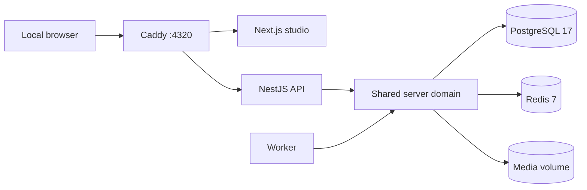

# Development

Architecture, native development, feature walkthroughs and every check command. For the quick Docker demo, see the [README](../README.md).

## Architecture



Apps compose shared packages. Browser code imports only contracts, UI and audio;
server domain code owns database/provider work. PostgreSQL is durable truth. Redis
coordinates media jobs and readiness; the worker reconciles database state, inspects
uploads and cleans eligible files. It also reconciles schedules into each device's
desired release and wakes the API, whose Socket.IO `/devices` gateway delivers it to
paired kiosks.

The live pipeline is Gemini transcription → approved release knowledge → Gemini
generation with validated tools → Gemini speech, all on one free-tier Google AI Studio
key. OpenAI is an optional explicit alternative for generation. Live audio stays
transient in its owning API process; without a key, demo mode quotes approved text.

See [the architecture decisions](DECISIONS.md),
[implementation progress](PROGRESS.md) and
[the supplied specification](01-robot-voice.md).

## Prerequisites

- Docker Desktop with Linux containers and Compose v2.24 or newer.
- pnpm 10.34.5. If needed: `corepack enable`, then
  `corepack prepare pnpm@10.34.5 --activate`.
- Node 22.23.2. The workspace pins `useNodeVersion`, so pnpm obtains the correct
  runtime for project commands without replacing a different host Node version.
- Internet for the first dependency/image install; no provider account is required.

## Run the complete local demo

From the repository root:

```sh
pnpm install --frozen-lockfile
pnpm setup:local
pnpm demo:up
```

Open [Svara](http://localhost:4320), the
[media library](http://localhost:4320/studio/media),
[voice lab](http://localhost:4320/studio/voice-lab),
[component gallery](http://localhost:4320/studio/design-system), or
[API reference](http://localhost:4320/api/docs).

Setup creates ignored `.env` and `.env.compose` files with fresh secrets and never
overwrites existing files. Compose builds the apps, runs migration and seed init
jobs, and waits for health checks. Only `127.0.0.1:4320` is exposed.
Stop with `pnpm demo:down`; named data volumes are retained.

The studio requires sign-in. Choose **Create a workspace** at `/login` to create
your own organisation and owner account. The seed creates the fictional Himal and
Riverside organisations, five staff accounts and reusable authoring examples.
Read the generated passwords in `.local/setup/demo-staff.json`; native and
Compose modes share this ignored file. No default password is committed. The voice
lab and component gallery additionally require local fixture
mode, including after sign-in. Free provider account instructions are linked above.

Sign in as the seeded Himal owner to inspect **Campus Admissions Guide → Releases
→ Version 1**. Its current draft deliberately has a missing Nepali greeting to
demonstrate readiness checks; the published version remains complete. An unapproved,
unselected fee draft demonstrates safe fallback. Repeating setup in the same launch
mode preserves edits, archive state and deleted content in completed bundles.

## Native development

Stop the full demo first if running: `pnpm demo:down`.

```sh
pnpm setup:local
pnpm infra:up
pnpm db:generate
pnpm db:migrate
pnpm db:seed
pnpm dev
```

Use `http://localhost:4320`. Native web uses port 3001, API 4100, worker 4101,
PostgreSQL 5434 and Redis 6381. Port 3001 avoids an unrelated service on this machine;
containers use web port 3000 internally. Ctrl+C stops the coordinated app watchers;
`pnpm infra:down` stops infrastructure while retaining data.

Before starting the native worker, install FFmpeg/ffprobe and configure the explicit
development inspection setting described in [media inspection setup](MEDIA-INSPECTION.md).
The seed command compiles its image inspector before importing the PNG example.
Compose includes the Linux ffprobe sandbox. The worker watcher compiles inspection
children as well as its main process, so new jobs use the current emitted code.

Compose and native modes share the development database but use different media
stores. Switching modes does not transfer files, and reseeding preserves existing
references. Keep the existing demo in its original mode unless its media files have
also been transferred. See [local storage](OPERATIONS.md#configuration).

## Explore the media library

1. Sign in as an owner or administrator and open **Media**. Choose a JPEG/PNG image
   or an H.264/AAC MP4 within the displayed limits, then select **Upload file**.
2. Wait for inspection. Ready images and videos can be previewed or downloaded;
   rejected files show an explanation. Operators and viewers can inspect the library.
3. Use search/type/status filters or confirm **Remove** to request cleanup.

Files remain private to the organisation. See [media processing](MEDIA-INSPECTION.md)
for the upload, sandbox, range serving and cleanup boundaries.

## Explore the voice lab

1. Choose English or Nepali and run a scripted scenario. The admissions facts are
   synthetic; the missing-fee scenario demonstrates an unsupported question.
2. Select the long answer and press Interrupt. Partial subtitles remain labelled;
   changing language or choosing End & clear cancels and clears the current turn.
3. Test microphone capture separately. Frames remain in the browser; this is not
   recognition. Stop is available during permission prompts and capture ends after
   30 seconds. Navigation and language changes release the microphone.
4. Test the speaker with a generated 440 Hz tone. This uses the actual PCM worklet
   queue. English/Nepali speech clips are not bundled, so fixture answers stay
   explicitly text-only. Typed questions receive a fixture notice, not generated facts.

See [M1 design, evidence and limits](M1-VOICE.md). Restart `pnpm dev` after editing
worklet source so the compiled public worklet modules are refreshed.

## Pair a kiosk and schedule it

1. In **Devices**, register a kiosk and choose **Pair**. Open the kiosk link in another
   browser profile (or the **Device simulator**) and enter the code.
2. Choose **Open display** on the kiosk for its second screen.
3. In **Events & Deployments**, schedule a published release or start an override. The
   kiosk downloads and verifies it, shows it, and its delivery history reports the
   acknowledgement. **Revoke** returns the kiosk to pairing at once.

See [M4 devices](M4-DEVICES.md) and [M5 schedules](M5-SCHEDULES.md).

## Talk to a kiosk or a public link

1. Open **Playground** (bottom of the navigation), choose a bot and release, and ask a
   question. **What happened** lists what was heard, the tools used and the passages
   cited. Without a live key this is labelled demo mode and quotes approved text only.
2. A paired kiosk with an applied release shows **Ask this kiosk** beside its slides.
   Asking for a slide by name shows it on the kiosk and, when authored for it, on the
   display. **Stop speaking** ends an answer at once.
3. In **Settings → Public assistant links**, create a link for a published release and
   open it in another browser profile. Turning it off ends its open conversations.
4. **Sessions** lists every conversation with its answers, tool and kiosk outcomes and
   measured timings.

See [M6 conversations](M6-CONVERSATIONS.md) and ADR 027.

## Measure, back up and recover

- **Analytics** shows measured response timings and recorded outcomes, live and demo kept
  apart. A stage with too few measurements says so instead of showing a number.
- `pnpm backup` (or `pnpm backup --compose` for the Docker demo) writes a verified backup
  to `.local/backups/`. `pnpm restore <dir>` restores it into a separate `svara_restore`
  database and checks every table.
- `pnpm demo:reset svara_dev` returns the native demo to a fresh seed after taking a
  backup.

Runbooks for restore, reset, retention and shutdown are in
[operations](OPERATIONS.md). See [M7 operations](M7-OPERATIONS.md) and ADR 028.

## Verification

```sh
pnpm check                 # format, lint, types, unit coverage, contract drift, builds
pnpm audit                 # all dependency groups
pnpm test:integration      # requires native infrastructure
pnpm exec playwright install chromium
pnpm test:e2e              # requires the complete running app
pnpm test:e2e:live         # voice lab, schedules and kiosks on a stub-provider stack; run pnpm build first
pnpm eval:conversations    # fixed bilingual evaluation in demo mode (add --live with a key)
pnpm screenshots:handoff   # the seven handoff screenshots in demo mode; run pnpm build first
```

For the full Compose demo use `pnpm test:integration:container` instead of the native
integration command. `pnpm test:container` verifies production preview denial in a
separate container with networking disabled. `pnpm test:e2e` runs against the real staff
quotas from one IP, on one worker: a run spends about 26 of the 30 sign-ins allowed per
10 minutes, so wait that long before running the whole suite again. `pnpm screenshots` captures the actual
overview at five viewport sizes in ignored `artifacts/screenshots/`.

`pnpm contracts:generate` updates OpenAPI and HTTP types; `pnpm contracts:check`
fails on drift without rewriting them. Tests do not call speech/LLM providers.
Integration commands accept only the explicitly local `svara_test` database.

GitHub Actions (`.github/workflows/ci.yaml`) runs these checks on every push to `main`. See [contributing](../CONTRIBUTING.md),
[operations](OPERATIONS.md), [API contracts](API.md), and
[dependency decisions](DEPENDENCIES.md).
